# Projet eBank : Partie 3

## Frontend Angular (comptes, chatbot, Markdown et streaming)

---

## 1. Création du projet Angular

On crée le projet Angular (`ng new <nom-du-projet>`).


### 1.1 Installation de Bootstrap et Bootstrap Icons

On installe **Bootstrap** :


On installe **Bootstrap Icons** :


On fait l'installation via `npm install` :

```bash
npm install bootstrap bootstrap-icons
```


### 1.2 Import des styles

Puis on importe Bootstrap et Bootstrap Icons dans `src/styles.css` :

```css
/* You can add global styles to this file, and also import other style files */
@import "bootstrap/dist/css/bootstrap.min.css";
@import "bootstrap-icons/font/bootstrap-icons.min.css";
```

### 1.3 Lancement de l'application

On lance l'application avec `ng serve` :


Voilà l'interface de notre application :


---

## 2. Template Bootstrap : la barre de navigation (navbar)

On cherche un template Bootstrap simple sur <https://getbootstrap.com/docs/5.0/components/navbar> et voilà le template :

```html
<nav class="navbar navbar-expand-lg navbar-light bg-light">
  <div class="container-fluid">
    <a class="navbar-brand" href="#">Navbar</a>
    <button class="navbar-toggler" type="button" data-bs-toggle="collapse" data-bs-target="#navbarSupportedContent" aria-controls="navbarSupportedContent" aria-expanded="false" aria-label="Toggle navigation">
      <span class="navbar-toggler-icon"></span>
    </button>
    <div class="collapse navbar-collapse" id="navbarSupportedContent">
      <ul class="navbar-nav me-auto mb-2 mb-lg-0">
        <li class="nav-item">
          <a class="nav-link active" aria-current="page" href="#">Home</a>
        </li>
        <li class="nav-item">
          <a class="nav-link" routerLink="/accounts">Accounts</a>
        </li>
        <li class="nav-item dropdown">
          <a class="nav-link dropdown-toggle" href="#" id="navbarDropdown" role="button" data-bs-toggle="dropdown" aria-expanded="false">
            Dropdown
          </a>
          <ul class="dropdown-menu" aria-labelledby="navbarDropdown">
            <li><a class="dropdown-item" href="#">Action</a></li>
            <li><a class="dropdown-item" href="#">Another action</a></li>
            <li><hr class="dropdown-divider"></li>
            <li><a class="dropdown-item" href="#">Something else here</a></li>
          </ul>
        </li>
        <li class="nav-item">
          <a class="nav-link disabled" href="#" tabindex="-1" aria-disabled="true">Disabled</a>
        </li>
      </ul>
      <form class="d-flex">
        <input class="form-control me-2" type="search" placeholder="Search" aria-label="Search">
        <button class="btn btn-outline-success" type="submit">Search</button>
      </form>
    </div>
  </div>
</nav>

<router-outlet></router-outlet>
```

On le met dans `app.html`.

> Pour que `routerLink` fonctionne, il faut importer `RouterLink` (et `RouterOutlet`) dans le tableau `imports` du composant `App`.

### 2.1 Le menu ne marche pas : import du JavaScript de Bootstrap

Là, le menu ne marche pas : il faut **importer le JavaScript de Bootstrap**. Les styles seuls ne suffisent pas pour la liste déroulante et le bouton du menu.


On ajoute donc ceci dans `angular.json` (section `build → options`) :

```json
"styles": [
  "src/styles.css"
],
"scripts": [
  "node_modules/bootstrap/dist/js/bootstrap.bundle.js"
]
```

Et voilà : le JS est chargé et la navbar marche bien. On redémarre (`ng serve`) et la navbar s'affiche, avec la liste déroulante :


---

## 3. Le composant `Accounts`

On crée notre composant web avec :

```bash
ng g c accounts
```


On l'ajoute dans les routes (`app.routes.ts`) :

```ts
{ path: "accounts", component: Accounts },
```

> Les chemins Angular sont **sensibles à la casse** : le `path` doit être `"accounts"` (en minuscules) pour correspondre au `routerLink="/accounts"`.

Et on l'affiche dans la barre de navigation du template :

```html
<a class="nav-link" routerLink="/accounts">Accounts</a>
```

Et voilà, on va voir l'application : ça marche.


---

## 4. Appel du backend depuis le composant

On passe à démarrer notre backend, puis on écrit dans notre composant :

```ts
import {Component, inject} from '@angular/core';
import {HttpClient} from '@angular/common/http';

@Component({
  selector: 'app-accounts',
  imports: [],
  templateUrl: './accounts.html',
  styleUrl: './accounts.css',
})
export class Accounts {
  private http = inject(HttpClient);
  accounts$ = this.http.get('http://localhost:9999/EBANK-SERVICE/accounts');
}
```

> Les comptes sont gérés par **EBANK-SERVICE** (et non CUSTOMER-SERVICE).
>
> Dans les versions récentes d'Angular (v21), `HttpClient` est disponible par défaut. Dans les versions plus anciennes, il faut déclarer `provideHttpClient()` dans `app.config.ts`. Dans tous les cas, `provideHttpClient(...)` reste nécessaire pour enregistrer un **intercepteur** (voir section 8).

Avec un **Observable**, on ne peut afficher les données que si on s'y **abonne** (*subscribe*), ou avec le pipe `async` dans le template. On précise aussi le type :

```ts
accounts$ = this.http.get<any[]>('http://localhost:9999/EBANK-SERVICE/accounts');
```

On ajoute ceci dans le template `accounts.html` (il faut aussi importer `AsyncPipe` dans le composant) :

```html
<div class="p-3">
  @if (accounts$ | async; as accountList) {
    <table class="table">
      <thead>
        <tr>
          <th>ID</th>
          <th>Balance</th>
          <th>Date</th>
          <th>Type</th>
          <th>CustomerId</th>
        </tr>
      </thead>

      <tbody>
        @for (acc of accountList; track acc.id) {
          <tr>
            <td>{{ acc.id }}</td>
            <td>{{ acc.balance }}</td>
            <td>{{ acc.createdAt }}</td>
            <td>{{ acc.type }}</td>
            <td>{{ acc.customerId }}</td>
          </tr>
        }
      </tbody>
    </table>
  }
</div>
```

---

## 5. Problème CORS

On teste : ça ne marche pas, car il y a un **problème CORS** (*Cross-Origin Resource Sharing*).

C'est-à-dire que notre backend n'autorise pas un frontend qui vient d'un autre nom de domaine (ici le frontend est sur `localhost:4200`, et la Gateway sur `localhost:9999`).

On ajoute donc dans le `application.yml` de la **Gateway** :

```yaml
spring:
  cloud:
    gateway:
      server:
        webflux:
          globalcors:
            cors-configurations:
              '[/**]':
                allowed-origins: "*"
                allowed-methods: "*"
                allowed-headers: "*"
```

> En production, on remplacera `"*"` par l'origine du frontend (par ex. `http://localhost:4200`).

On redémarre la Gateway, et c'est bon : nos comptes s'affichent, ça marche bien.


---

## 6. Création du modèle

On passe à la création de notre **modèle** avec les deux interfaces `Account` et `AccountList`. Voilà notre modèle :

```ts
export interface Account {
  id?: string,
  balance?: number,
  createdAt?: string,
  type?: string,
  customerId?: number
}

export interface AccountList {
  accounts: Account[]
}
```


### 6.1 Modèle final avec gestion d'état

On modifie ensuite notre modèle (`account.model.ts`) pour gérer **l'état de la requête** (succès / erreur) : `AccountListState` remplace `AccountList`.

```ts
export interface Account {
  id?: string,
  balance?: number,
  createdAt?: string,
  type?: string,
  customerId?: number
}

export enum RequestStatus {
  SUCCESS = 0,
  ERROR = 1
}

export interface AccountListState {
  accounts?: Account[],
  status?: RequestStatus,
  message?: string
}
```

### 6.2 Composant avec `catchError`

Pour **attraper les erreurs**, on utilise les opérateurs RxJS `map` et `catchError` :

```ts
import {Component, inject} from '@angular/core';
import {HttpClient} from '@angular/common/http';
import {AsyncPipe} from '@angular/common';
import {Account, AccountListState, RequestStatus} from '../model/account.model';
import {catchError, map, Observable, of} from 'rxjs';

@Component({
  selector: 'app-accounts',
  imports: [
    AsyncPipe
  ],
  templateUrl: './accounts.html',
  styleUrl: './accounts.css',
})
export class Accounts {
  private http = inject(HttpClient);

  // Permet d'utiliser l'enum dans le template
  protected readonly RequestStatus = RequestStatus;

  accounts$: Observable<AccountListState> = this.http
    .get<Account[]>('http://localhost:9999/EBANK-SERVICE/accounts')
    .pipe(
      map(resp => ({ accounts: resp, status: RequestStatus.SUCCESS })),
      catchError(err => of({ status: RequestStatus.ERROR, message: err.statusText }))
    );
}
```

Et dans le template :

```html
<div class="p-3">
  @if (accounts$ | async; as state) {
    <table class="table">
      <thead>
        <tr>
          <th>ID</th>
          <th>Balance</th>
          <th>Date</th>
          <th>Type</th>
          <th>CustomerId</th>
        </tr>
      </thead>

      <tbody>
        @for (acc of state.accounts; track acc.id) {
          <tr>
            <td>{{ acc.id }}</td>
            <td>{{ acc.balance }}</td>
            <td>{{ acc.createdAt }}</td>
            <td>{{ acc.type }}</td>
            <td>{{ acc.customerId }}</td>
          </tr>
        }
      </tbody>
    </table>
  }
</div>
```

On démarre, et c'est bon : toute la liste des comptes s'affiche.


---

## 7. Affichage des erreurs

Comme on a un **état** (`state`), on peut faire :

```html
@if (state.status == RequestStatus.ERROR) {
  <div class="text-danger">
    {{ state.message }}
  </div>
} @else if (state.status == RequestStatus.SUCCESS) {
  <!-- le tableau des comptes -->
}
```

Ainsi, s'il y a une erreur, on affiche le **message d'erreur**. On met notre tableau dans le cas succès, et le `div` d'erreur dans le cas erreur.

On essaie de **simuler une erreur** avec un endpoint erroné :

```ts
'http://localhost:9999/EBANK-SERVICE/act'
```

Et voilà, « Not Found » s'affiche dans le navigateur. On corrige donc notre endpoint (retour à `/accounts`).


---

## 8. Affichage « loading » (requête en cours) avec un intercepteur

On passe à l'affichage d'un indicateur **« in progress »** pendant que la requête est en cours.

Pour cela, on passe par un **intercepteur HTTP**, et on crée d'abord un service :

```bash
ng g s services/loading
```

On utilise un **signal** de type booléen, avec la valeur par défaut `false`, et on crée une méthode pour modifier le chargement (`setLoading`).


### 8.1 Le service `LoadingService`

Première version (le nom de la méthode ne correspondait pas à ce qu'elle faisait : `setLoaded()` mettait toujours à `true`) :

```ts
loading = signal<boolean>(false);
public isLoading = this.loading.asReadonly();
public setLoaded() {
  this.loading.set(true);
}
```

On la modifie pour passer la valeur en paramètre :

```ts
import {Injectable, signal} from '@angular/core';

@Injectable({
  providedIn: 'root',
})
export class LoadingService {
  loading = signal<boolean>(false);
  public isLoading = this.loading.asReadonly();

  public setLoading(value: boolean) {
    this.loading.set(value);
  }
}
```

> On expose `isLoading` en **public** pour pouvoir l'appeler depuis le template (un membre `private` n'est pas accessible dans le template ; `protected` l'est dans le composant lui-même).

### 8.2 L'intercepteur `loading`

On crée aussi notre intercepteur (`ng g interceptor interceptors/loading`). À chaque fois que j'envoie une requête, elle passe par cet intercepteur. On y injecte notre `LoadingService` :

```ts
const loadingService = inject(LoadingService);
```

Au moment où la requête part, on passe le chargement à `true`. Une fois la réponse arrivée, on laisse passer la réponse et on utilise l'opérateur `finalize` pour repasser à `false` :

```ts
import {HttpInterceptorFn} from '@angular/common/http';
import {inject} from '@angular/core';
import {finalize} from 'rxjs';
import {LoadingService} from '../services/loading';

export const loadingInterceptor: HttpInterceptorFn = (req, next) => {
  const loadingService = inject(LoadingService);

  loadingService.setLoading(true);

  return next(req).pipe(
    finalize(() => {
      loadingService.setLoading(false);
    })
  );
};
```

On a ainsi un intercepteur qui fait ce travail **une fois pour toute l'application**.

> Remarque : avec un simple booléen, si plusieurs requêtes sont lancées en parallèle, le spinner disparaît dès que la première se termine. Pour un cas plus robuste, on utilise un **compteur** de requêtes en cours.

### 8.3 Enregistrement de l'intercepteur

On ajoute notre intercepteur dans `app.config.ts` pour qu'il fonctionne bien :

```ts
import {ApplicationConfig} from '@angular/core';
import {provideRouter} from '@angular/router';
import {provideHttpClient, withInterceptors} from '@angular/common/http';
import {routes} from './app.routes';
import {loadingInterceptor} from './interceptors/loading-interceptor';

export const appConfig: ApplicationConfig = {
  providers: [
    provideRouter(routes),
    provideHttpClient(withInterceptors([loadingInterceptor]))
  ]
};
```

(Le nom du fichier de l'intercepteur dépend de ce que génère `ng g interceptor`.)

### 8.4 Le spinner dans le composant

Dans le composant `Accounts`, on injecte le service :

```ts
public loadingService = inject(LoadingService);
```

Puis on ajoute le spinner dans notre `div`, pour le chargement des données :

```html
@if (loadingService.isLoading()) {
  <div class="spinner-border text-primary" role="status">
    <span class="visually-hidden">Loading ...</span>
  </div>
}
```

### 8.5 Test

On essaie de mettre le navigateur en mode réseau lent (**Slow 3G** / **Slow 4G**, dans l'onglet *Network* des outils de développement), et voilà : on voit notre **spinner bleu**.


---

## 9. Intégration du chatbot dans Angular

On passe à l'intégration de notre bot. On crée le composant `BotUi` (`ng g c bot-ui`) et on l'ajoute dans les routes :

```ts
{ path: "bot", component: BotUi },
```

Puis on ajoute un lien dans la navbar de `app.html` :

```html
<li class="nav-item">
  <a class="nav-link" routerLink="/bot">ChatBot</a>
</li>
```


Et voilà notre bot est ajouté dans la page :


### 9.1 Le template HTML du composant `bot-ui`

On modifie le HTML de notre composant `bot-ui` (champ de saisie + bouton de recherche avec une icône Bootstrap) :

```html
<div class="p-3">

  <div class="card-body">
    <input type="text" class="form-control m-2" style="display: inline; width: 80%">
    <button class="btn btn-primary" style="display: inline">
      <i class="bi bi-search"></i>
    </button>
  </div>

</div>
```


Et voilà, c'est bon.

### 9.2 La variable `query` et le binding `ngModel`

On déclare la variable `query` dans le fichier TypeScript de notre `BotUi` :

```ts
import { Component } from '@angular/core';

@Component({
  selector: 'app-bot-ui',
  imports: [],
  templateUrl: './bot-ui.html',
  styleUrl: './bot-ui.css',
})
export class BotUi {
  query: any;
}
```

Puis on fait un **binding via `ngModel`** dans le template de `BotUi` (`[(ngModel)]="query"`, ce qui demande d'importer `FormsModule`). Ensuite, on fera le **streaming**, mais pas pour le moment.

### 9.3 Vérification du bot avec l'URL

Ici, je vérifie à nouveau que mon bot marche : je demande la liste des comptes, et c'est très bien, il les affiche, via l'URL :

<http://localhost:9999/EBANK-BOT/chat?query=donne%20moi%20la%20liste%20des%20comptes%20bancaires>


### 9.4 Appel du bot avec `HttpClient`

On injecte `HttpClient` dans notre composant bot :

```ts
import {Component, inject} from '@angular/core';
import {FormsModule} from '@angular/forms';
import {HttpClient} from '@angular/common/http';

@Component({
  selector: 'app-bot-ui',
  imports: [
    FormsModule
  ],
  templateUrl: './bot-ui.html',
  styleUrl: './bot-ui.css',
})
export class BotUi {
  query: any;
  http: HttpClient = inject(HttpClient);
}
```


> Dans cette version (Angular 21), il n'est **pas nécessaire** d'ajouter `HttpClient` dans `app.config.ts` : il est fourni par défaut (sauf pour déclarer des intercepteurs, comme ci-dessus).

On revient au bot : on déclare une réponse sous forme d'**Observable**. Le type est `Observable<any>`, et on utilise le point d'exclamation (`!`) pour ne pas l'initialiser à la déclaration, mais seulement dans la méthode `askAgent()`.

```ts
import {Component, inject} from '@angular/core';
import {FormsModule} from '@angular/forms';
import {HttpClient} from '@angular/common/http';
import {Observable} from 'rxjs';

@Component({
  selector: 'app-bot-ui',
  imports: [
    FormsModule
  ],
  templateUrl: './bot-ui.html',
  styleUrl: './bot-ui.css',
})
export class BotUi {
  query: any;
  http: HttpClient = inject(HttpClient);
  response$!: Observable<any>;

  askAgent() {
    this.response$ = this.http.get("http://localhost:9999/EBANK-BOT/chat?query=" + this.query);
  }
}
```

Et dans la page HTML, dans un `div`, on affiche la réponse :

```html
<div class="card-body">
  @if (response$ | async; as botResponse) {
    {{ botResponse }}
  }
</div>
```

### 9.5 `responseType: 'text'`

On teste : on voit bien la réponse, la liste des comptes :


Maintenant, on veut que, quand on envoie la requête HTTP, le client sache que la réponse est du **texte** (le backend renvoie `text/plain`) :

```ts
askAgent() {
  this.response$ = this.http.get("http://localhost:9999/EBANK-BOT/chat?query=" + this.query,
    { responseType: 'text' }
  );
}
```

Maintenant, si on tape la question, la réponse s'affiche directement dans la page (plus besoin d'aller dans les outils de développement pour voir la réponse) :


> **Amélioration :** plutôt que de concaténer la question dans l'URL, on utilise les `params` de `HttpClient`, qui encodent correctement les espaces, accents et caractères spéciaux :
>
> ```ts
> this.http.get("http://localhost:9999/EBANK-BOT/chat", {
>   params: { query: this.query },
>   responseType: 'text'
> });
> ```

---

## 10. Affichage en Markdown (ngx-markdown)

La réponse du bot est du **Markdown** (tableaux, listes…). On installe donc la dépendance :

```bash
npm i ngx-markdown
```

(selon la version, la bibliothèque `marked` peut devoir être installée aussi : `npm i marked`.)

Et dans la configuration (`app.config.ts`), on ajoute `provideMarkdown()` :

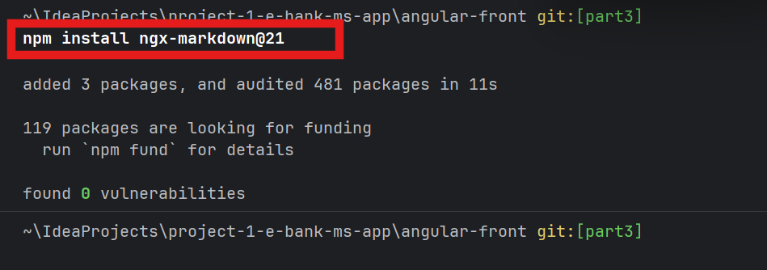

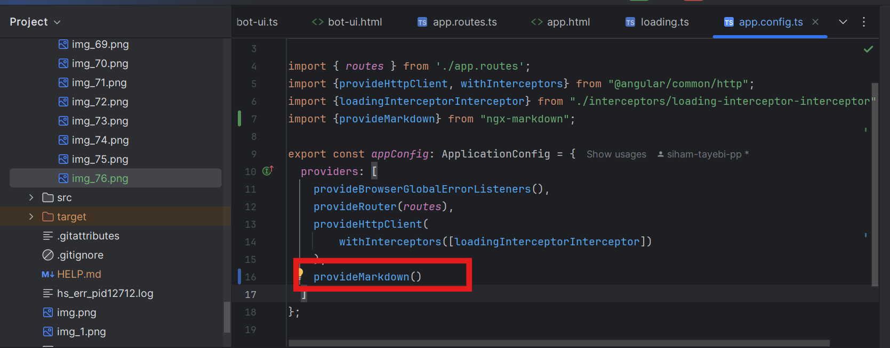

```ts
providers: [
  provideRouter(routes),
  provideHttpClient(withInterceptors([loadingInterceptor])),
  provideMarkdown()
]
```

On importe `MarkdownComponent` dans les `imports` du composant `BotUi`, et on l'utilise dans le HTML du composant bot :

```html
<markdown [data]="botResponse">

</markdown>
```

Et on teste : on demande « Donne-moi la liste des comptes bancaires » :

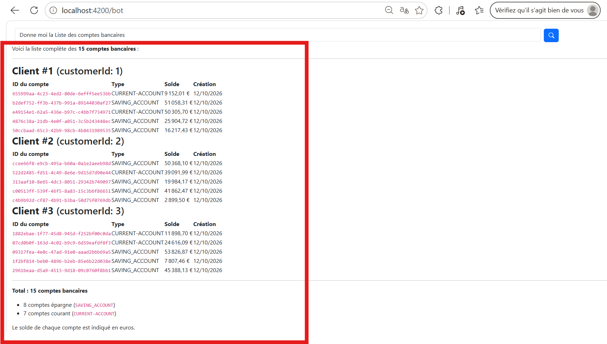

Puis « Donne-moi la liste des clients ». Ça marche très bien :

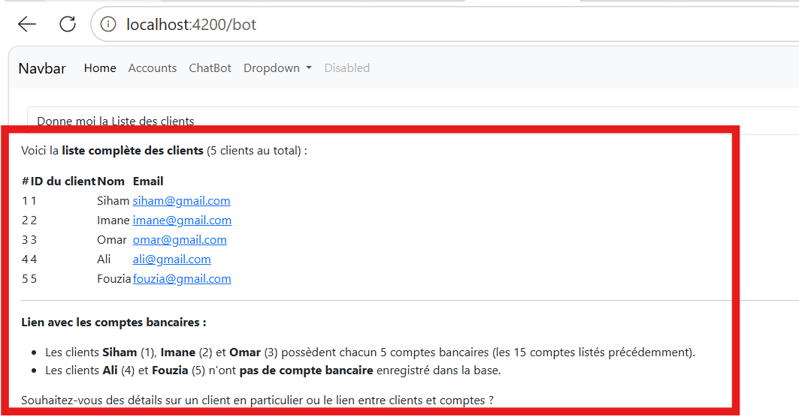

On demande aussi : « Donne-moi la liste des comptes bancaires sous forme d'un tableau » :

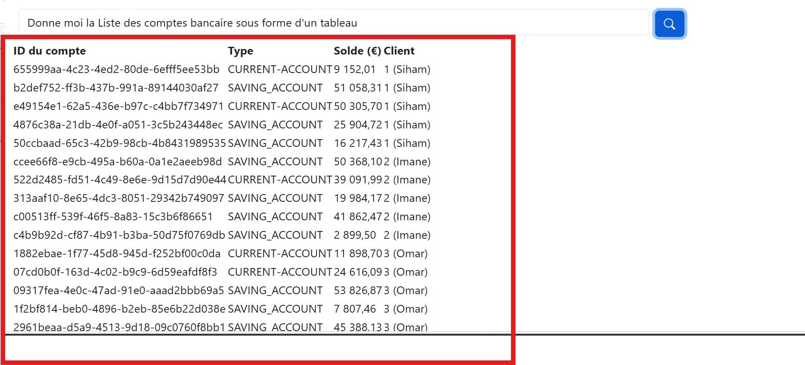

« Donne-moi la liste des comptes bancaires du client Imane sous forme d'un tableau » :

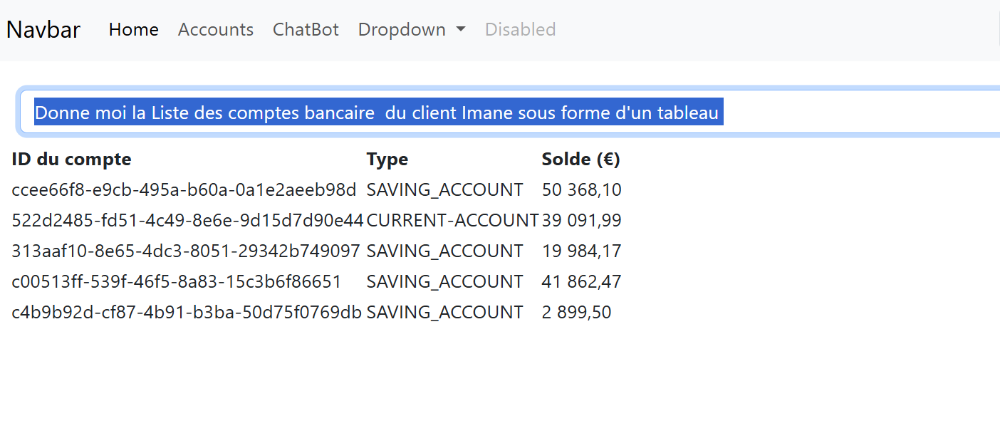

On veut aussi **ajouter un compte** : « Ajoute un compte bancaire avec balance=3400 de type current account et pour customer c'est Siham ». C'est bon, ça ajoute très bien :

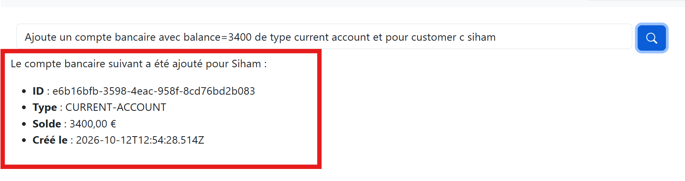

Pour vérifier, on affiche tous les comptes de Siham pour voir s'il a été ajouté : « Donne-moi la liste des comptes bancaires de Siham sous forme de tableau ». Et voilà, on le voit bien ici :

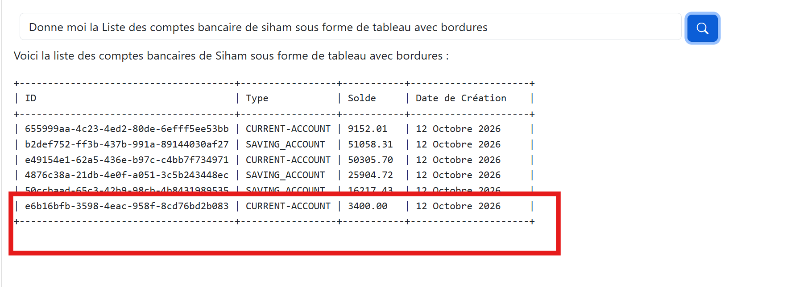

---

## 11. Spinner dans le chatbot

On ajoute aussi le **spinner « en cours »** pour le cas où la réponse n'est pas encore prête, comme dans le cas des accounts avant :

```html
@if (loadingService.isLoading()) {
  <div class="spinner-border text-primary" role="status">
    <span class="visually-hidden">Loading ...</span>
  </div>
}
```

Mais on injecte donc le service dans notre `bot-ui.ts` :

```ts
loadingService = inject(LoadingService);
```

On teste, et voilà : le spinner s'affiche en attendant la réponse :

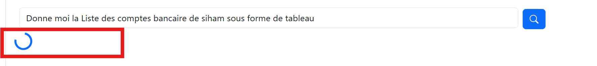

---

## 12. Streaming de la réponse

Maintenant, si on fait un chatbot, on aura besoin du **streaming** : dès qu'un morceau de la réponse arrive, on l'affiche, sans attendre que toute la réponse soit prête.

### 12.1 Côté backend (`ebank-bot`)

Pour faire ce streaming, on va dans `ebank-bot` pour ajouter un nouvel endpoint `/chat-streaming`. Au lieu de retourner un `String`, on retourne un **`Flux<String>`**.

On ajoute ceci dans l'agent (`EbankAIAgent`) :

```java
public Flux<String> chatStream(String query) {
    return chatClient
            .prompt()
            .user(query)
            .advisors(a -> a.param(
                    ChatMemory.CONVERSATION_ID,
                    "user-1"
            ))
            .stream()
            .content();
}
```

Et ceci dans le contrôleur :

```java
@GetMapping(value = "/chat-streaming", produces = MediaType.TEXT_PLAIN_VALUE)
public Flux<String> chatStreaming(
        @RequestParam(name = "query", defaultValue = "Bonjour") String query) {

    return ebankAIAgent.chatStream(query);
}
```

(imports : `reactor.core.publisher.Flux` et `org.springframework.http.MediaType`.)

On redémarre le bot. Et voilà, nos comptes s'affichent en mode streaming :

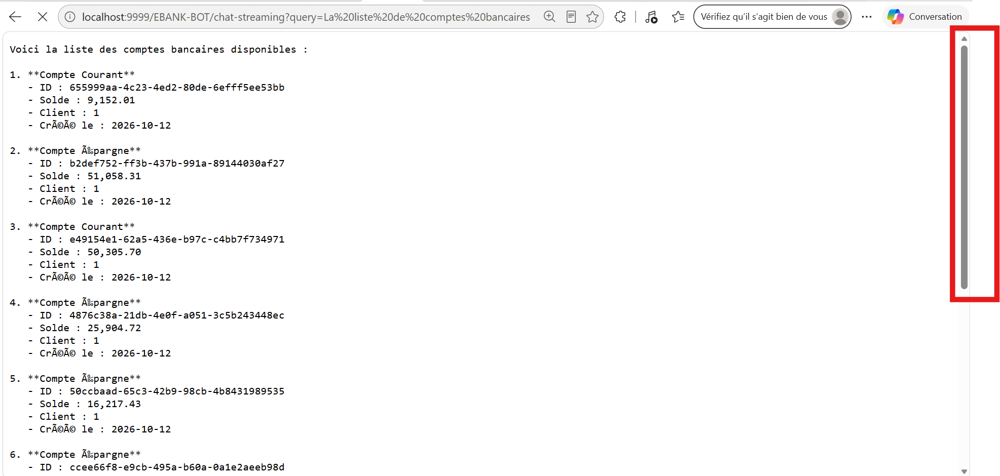

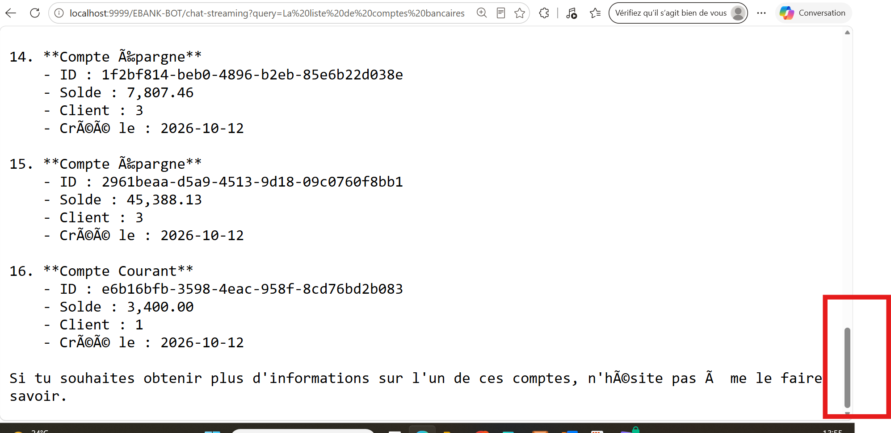

### 12.2 Côté Angular

Maintenant, comment faire ce streaming dans Angular ? On crée, dans la partie bot, une méthode `askAgentStream()` avec un `pipe` : à chaque événement qui arrive, on utilise `map`.

La requête est configurée avec `observe: 'events'` et `reportProgress: true` pour recevoir les événements de progression du téléchargement :

```ts
import {Component, inject} from '@angular/core';
import {FormsModule} from '@angular/forms';
import {HttpClient, HttpDownloadProgressEvent, HttpEventType} from '@angular/common/http';
import {map, Observable} from 'rxjs';
import {MarkdownComponent} from 'ngx-markdown';
import {LoadingService} from '../services/loading';

@Component({
  selector: 'app-bot-ui',
  imports: [FormsModule, MarkdownComponent, AsyncPipe],
  templateUrl: './bot-ui.html',
  styleUrl: './bot-ui.css',
})
export class BotUi {
  query: string = '';
  private http = inject(HttpClient);
  loadingService = inject(LoadingService);
  response$!: Observable<any>;

  askAgentStream() {
    this.response$ = this.http.get("http://localhost:9999/EBANK-BOT/chat-streaming", {
      params: { query: this.query },
      responseType: 'text',
      observe: 'events',
      reportProgress: true
    }).pipe(
      map(event => {
        switch (event.type) {
          case HttpEventType.Sent:
            return { type: 'Sent' };
          case HttpEventType.DownloadProgress:
            return { type: 'Response', content: (event as HttpDownloadProgressEvent).partialText };
          case HttpEventType.Response:
            return { type: 'Response', content: event.body };
          default:
            return { type: 'Other', data: event };
        }
      })
    );
  }
}
```

(`AsyncPipe` s'importe depuis `@angular/common`.)

Et dans le HTML, on appelle `askAgentStream()` :

```html
<button (click)="askAgentStream()" class="btn btn-primary" style="display: inline">
  <i class="bi bi-search"></i>
</button>
```

On teste donc : voilà, ça marche en streaming, la réponse s'affiche en temps réel :

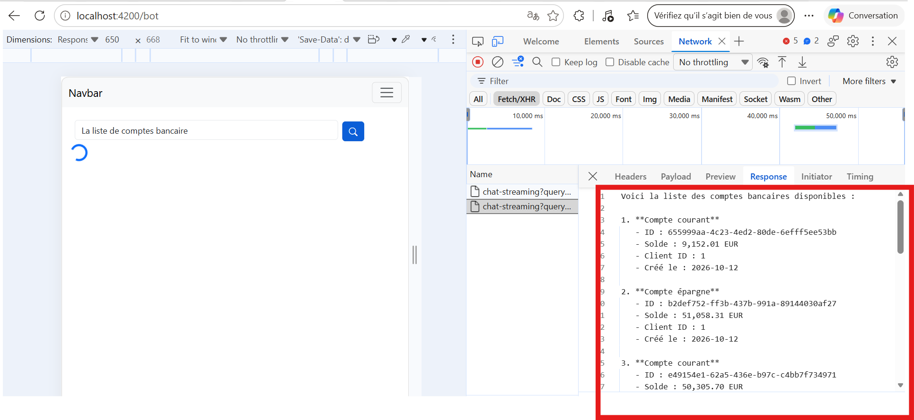

Dans le template, on affiche les événements de type `Response` avec le composant Markdown :

```html
<div class="card-body">
  @if (response$ | async; as resp) {
    @if (resp.type == 'Response') {
      <markdown [data]="resp.content"></markdown>
    }
  }
</div>
```

Et on met `reportProgress: true` dans les options de la requête (déjà fait ci-dessus). On teste, et voilà, ça s'affiche en mode streaming :

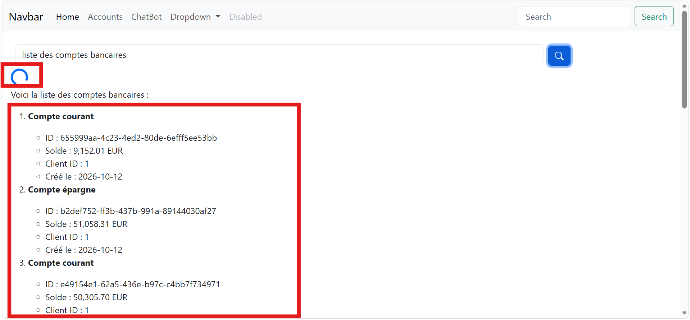

On teste avec « liste des comptes bancaires sous forme de tableau avec bordure » : c'est bon, le tableau s'affiche en streaming :

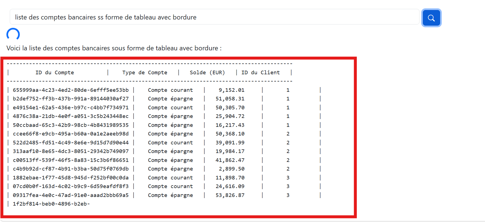

---

## 13. Récapitulatif des corrections apportées

| # | Endroit | Erreur dans la version d'origine | Correction |
|---|---|---|---|
| 1 | Image `img_52` | Crochets parasites autour du lien image | Lien image corrigé |
| 2 | `angular.json` | Emplacement peu clair | Précisé : `build → options` (`styles` + `scripts`) |
| 3 | Navbar | `RouterLink` / `RouterOutlet` à importer non mentionnés | Remarque ajoutée |
| 4 | Commande | `ng g c accoutns` (faute de frappe) | `ng g c accounts` |
| 5 | Route | `path: "Accounts"` alors que `routerLink="/accounts"` (Angular est sensible à la casse) | `path: "accounts"` |
| 6 | Premier appel HTTP | URL `CUSTOMER-SERVICE/accounts` alors que les comptes sont dans EBANK-SERVICE | `EBANK-SERVICE/accounts` |
| 7 | Composant | `AsyncPipe` non importé dans la première version | Ajouté à `imports` |
| 8 | Gateway YAML (CORS) | Indentation cassée | YAML valide ; remarque sur `"*"` en production |
| 9 | Appel HTTP | `get<Observable<AccountListState>>(...)` (mauvais type) | `get<Account[]>(...)` + `map` vers `AccountListState` |
| 10 | `catchError` | `errorMessage` alors que l'interface déclare `message` ; paramètre `caught` inutile | `message: err.statusText` |
| 11 | Template | `RequestStatus` utilisé dans le template sans être exposé par le composant | `protected readonly RequestStatus = RequestStatus;` |
| 12 | Template | `track acc` (suit l'objet entier) | `track acc.id` |
| 13 | `LoadingService` | `setLoaded()` mettait toujours `true` | `setLoading(value: boolean)` |
| 14 | Intercepteur | Enregistrement dans `app.config.ts` non montré | `provideHttpClient(withInterceptors([...]))` |
| 15 | Spinner | Accès à `isLoading` impossible depuis le template | Service injecté en `public` dans le composant |
| 16 | Spinner | Booléen unique fragile avec plusieurs requêtes simultanées | Remarque ajoutée (compteur de requêtes) |
| 17 | `BotUi` | Variable `askAgent: any;` laissée dans une version intermédiaire (méthode et propriété du même nom) | Supprimée, `askAgent()` est une vraie méthode |
| 18 | `BotUi` | Question concaténée dans l'URL (`"...?query=" + this.query`), mal encodée avec espaces/accents/`&` | Utilisation de `params: { query: this.query }` |
| 19 | Template `bot-ui` | `ngModel` et `(click)` non montrés dans le HTML | Binding `[(ngModel)]="query"` et `(click)` précisés |
| 20 | Template streaming | Faute de frappe `'Respponse'` : la condition n'était jamais vraie | `'Response'` |
| 21 | Streaming | `reportProgress` ajouté seulement à la fin | Inclus dès la déclaration de la requête |
| 22 | Markdown | `MarkdownComponent` à importer dans le composant non mentionné | Ajouté aux `imports` |
| 23 | Streaming backend | Imports `Flux` / `MediaType` non mentionnés | Ajoutés |
| 24 | `EbankAIAgent.chatStream` | `"user-1"` identique pour tous les utilisateurs (mémoire partagée) | Remarque conservée côté partie 2 (identifiant par utilisateur recommandé) |
| 25 | `HttpClient` | Il fallait `provideHttpClient()` dans les anciennes versions | Précisé : inutile par défaut en Angular 21, sauf pour les intercepteurs |
| 26 | Images | Les noms `img_68` à `img_75` sont réutilisés dans les parties 2 et 3 (même nom de fichier) | Utiliser des noms uniques (ex. `partie3_img_68.png`) pour éviter les écrasements |
| 27 | Orthographe / formulation | Nombreuses fautes de frappe et phrases incomplètes (« ngmodel », « streming », « intecepetoer »…) | Texte reformulé et corrigé |
