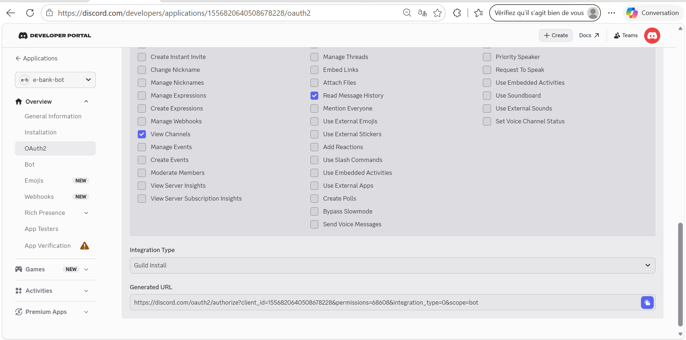
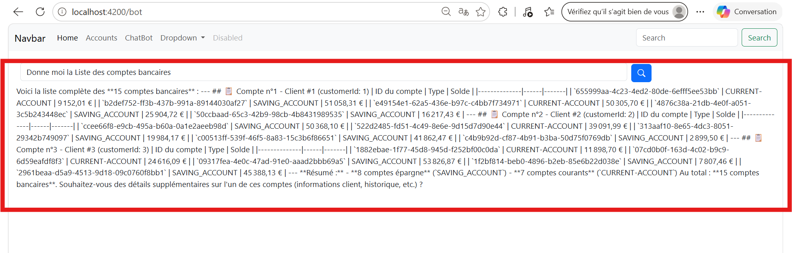
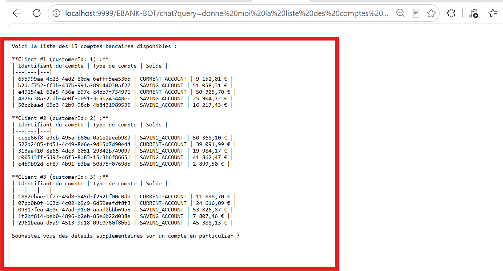
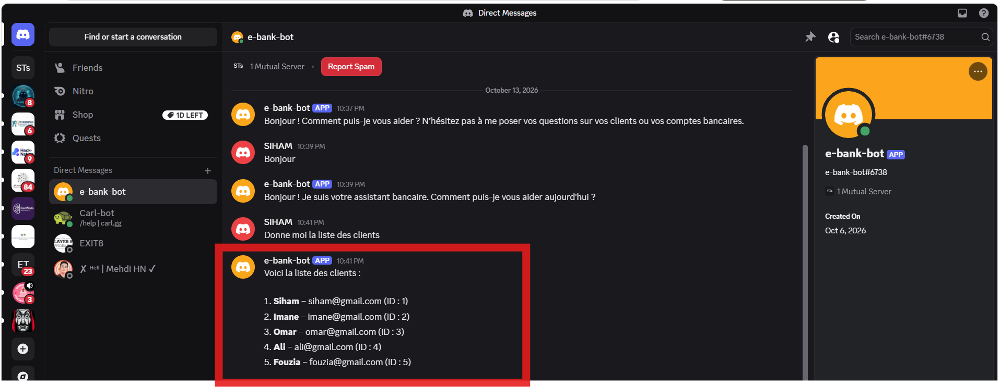
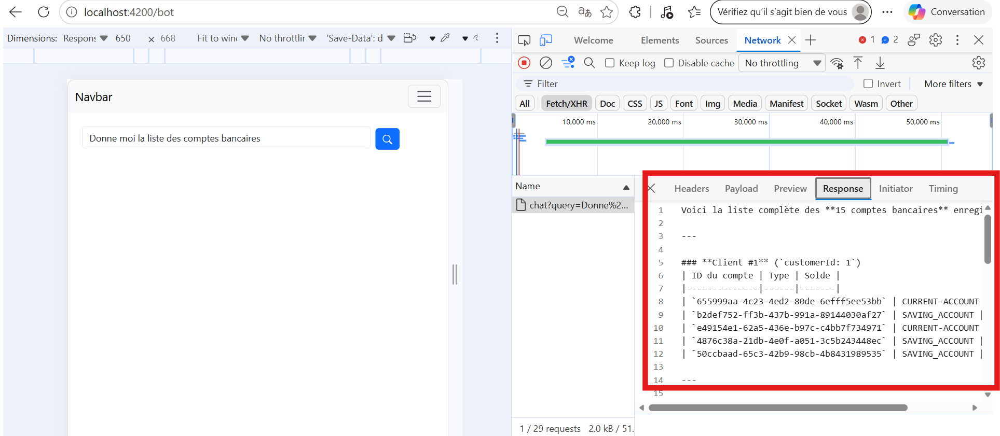
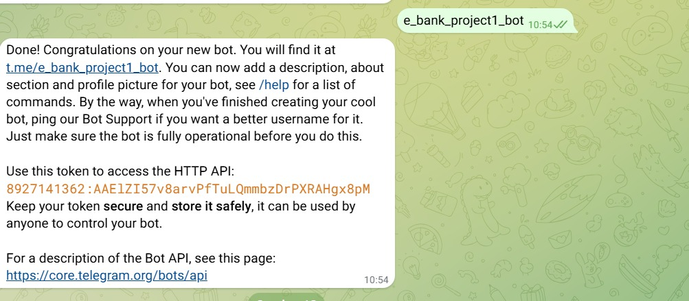
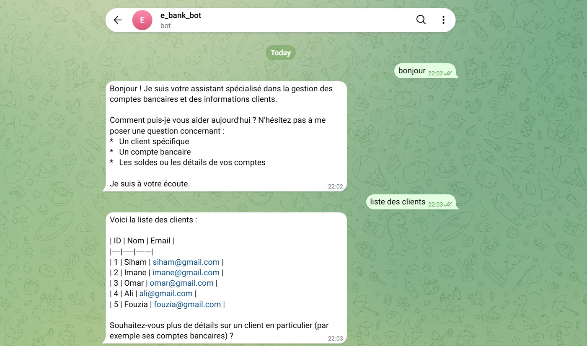
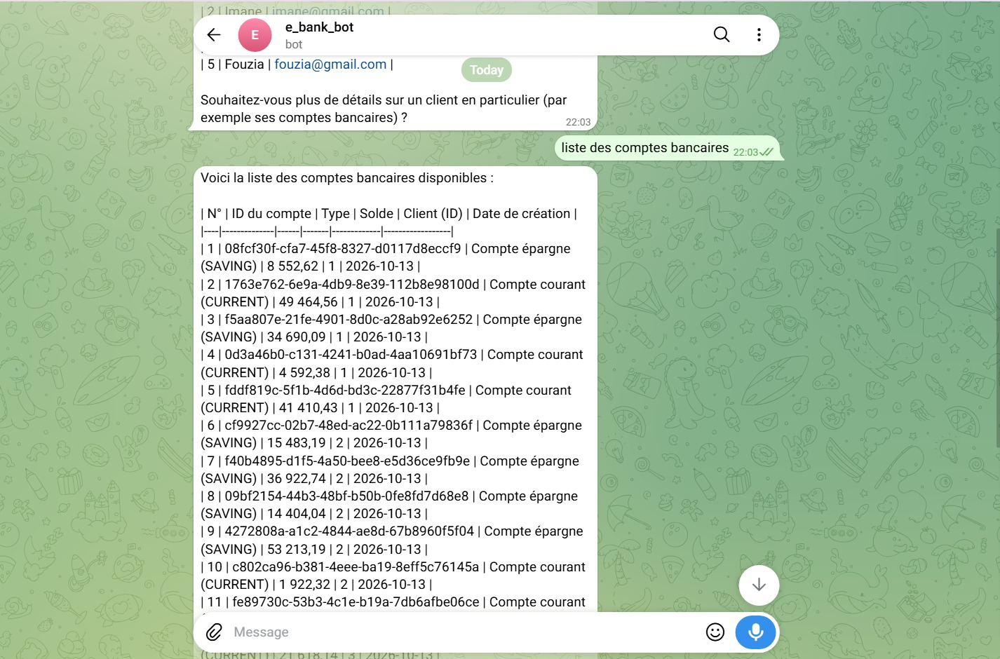

# Compte rendu : Projet eBank, Partie 2

## Création du chatbot avec Spring AI et MCP

---

## 1. Création du microservice `ebank-bot` (chatbot-service)

On passe à la création du **chatbot-service** (nommé `ebank-bot`), avec les dépendances suivantes :

| Dépendance | Rôle |
|---|---|
| Spring Web | Exposition de l'API REST du chatbot |
| OpenAI | LLM utilisé (on aurait pu utiliser **Ollama** ou **Gemini**, mais ici on utilise uniquement **OpenAI**) |
| Eureka Discovery Client | Enregistrement auprès du Discovery Service |
| Config Client | Récupération de la configuration |
| Actuator | Monitoring |


### 1.1 Configuration (`application.properties`)

Pour communiquer avec OpenAI, on a besoin d'une **clé d'API OpenAI** (`api-key`).

```properties
spring.application.name=ebank-bot
server.port=8088

# LLM OpenAI
spring.ai.openai.api-key=${OPENAI_API_KEY}
spring.ai.openai.chat.options.model=gpt-4o

# Découverte / configuration
eureka.client.enabled=true
spring.cloud.config.enabled=false
spring.cloud.config.discovery.enabled=false
```

> **Sécurité :** ne jamais écrire la clé d'API directement dans le fichier (ni dans Git). On la lit depuis une **variable d'environnement** (`OPENAI_API_KEY`). Il en va de même pour les tokens Telegram et Discord (voir plus loin).

### 1.2 Premier contrôleur de test

On crée un contrôleur `EbankChatbotController` qui utilise directement un `ChatClient` et on y expose l'endpoint `/chat`.

On ajoute aussi la dépendance **Swagger** (même dépendance que dans la partie 1) :

```xml
<dependency>
    <groupId>org.springdoc</groupId>
    <artifactId>springdoc-openapi-starter-webmvc-ui</artifactId>
    <version>3.1.1</version>
</dependency>
```

Et voilà, on fait une requête dans l'URL : *« c'est quoi Marrakech »*, et il répond :

<http://localhost:8088/chat?query=c%27quoi%20marakech>


Test via Swagger : <http://localhost:8088/swagger-ui/index.html#/ebank-chatbot-controller/chat>

**GET `/chat`**


On a dit « bonjour », et il répond « bonjour, comment puis-je t'aider ? ». C'est bon.

---

## 2. Ajout de la mémoire (Chat Memory)

On teste maintenant un point important : **les LLM sont stateless**, c'est-à-dire **sans mémoire**. Je lui dis mon nom, puis je lui demande plus tard s'il s'en souvient :


Il répond qu'il ne me connaît pas : il n'y a pas de mémoire.


C'est ce qu'on va corriger en **injectant `ChatMemory`** :

```java
public EbankChatbotController(ChatClient.Builder chatClient, ChatMemory chatMemory) {
    this.chatClient = chatClient
            .defaultAdvisors(MessageChatMemoryAdvisor.builder(chatMemory).build())
            .build();
}
```

Ici, on a construit un agent **avec mémoire**, qui conserve en mémoire les questions et les réponses de la conversation.

On essaie de lui dire « je suis Siham », puis de lui demander « c'est quoi mon nom ? » :


Il s'en souvient.

---

## 3. Passage au réel : `EbankAIAgent`

Ce qui précède n'était qu'un test. On passe au réel : on crée **`EbankAIAgent`** (l'agent IA) et on laisse le contrôleur ne faire que le relais.


### 3.1 L'agent `EbankAIAgent`

```java
package net.tayebi.ebankbot.controllers;

import org.springframework.ai.chat.client.ChatClient;
import org.springframework.ai.chat.client.advisor.MessageChatMemoryAdvisor;
import org.springframework.ai.chat.memory.ChatMemory;
import org.springframework.stereotype.Service;

@Service
public class EbankAIAgent {

    private final ChatClient chatClient;

    public EbankAIAgent(ChatClient.Builder chatClient, ChatMemory chatMemory) {
        this.chatClient = chatClient
                .defaultAdvisors(
                        MessageChatMemoryAdvisor.builder(chatMemory).build()
                )
                .build();
    }

    public String chat(String query) {
        return chatClient
                .prompt()
                .user(query)
                .advisors(a -> a.param(
                        ChatMemory.CONVERSATION_ID,
                        "user-1"
                ))
                .call()
                .content();
    }
}
```

> **Remarque :** `"user-1"` est un identifiant de conversation **fixe** : tous les utilisateurs partagent donc la même mémoire. Pour une vraie application, il faudra passer un identifiant par utilisateur (par ex. le `chatId` Telegram ou l'`id` de l'auteur Discord).

### 3.2 Le contrôleur `EbankChatbotController`

```java
package net.tayebi.ebankbot.controllers;

import lombok.AllArgsConstructor;
import org.springframework.web.bind.annotation.GetMapping;
import org.springframework.web.bind.annotation.RequestParam;
import org.springframework.web.bind.annotation.RestController;

@RestController
@AllArgsConstructor
public class EbankChatbotController {

    private EbankAIAgent ebankAIAgent;

    @GetMapping("/chat")
    public String chat(
            @RequestParam(name = "query", defaultValue = "Bonjour") String query) {

        return ebankAIAgent.chat(query);
    }
}
```


Mais **il ne connaît pas encore les données de notre application**.

---

## 4. Exposer les microservices via MCP (côté Customer Service)

On passe à l'utilisation de **MCP** pour **exposer nos microservices** via le protocole MCP.

Dans **customer-service**, on ajoute la dépendance **MCP Server** :

```xml
<dependency>
    <groupId>org.springframework.ai</groupId>
    <artifactId>spring-ai-starter-mcp-server-webmvc</artifactId>
</dependency>
```

Dans `CustomerService`, on utilise les annotations **`@McpTool`** (et `@McpToolParam` pour les paramètres) :

```java
package net.tayebi.customerservice.services;

import net.tayebi.customerservice.entities.Customer;
import net.tayebi.customerservice.repositories.CustomerRepository;
import org.springframework.ai.mcp.annotation.McpTool;
import org.springframework.ai.mcp.annotation.McpToolParam;
import org.springframework.stereotype.Service;

import java.util.List;

@Service
public class CustomerService {

    private final CustomerRepository customerRepository;

    public CustomerService(CustomerRepository customerRepository) {
        this.customerRepository = customerRepository;
    }

    @McpTool(description = "Get All customers")
    public List<Customer> getAllCustomers() {
        return customerRepository.findAll();
    }

    @McpTool(description = "Find Customer By id")
    public Customer findCustomerById(@McpToolParam(description = "The customer id") Long id) {
        return customerRepository.findById(id)
                .orElseThrow(() -> new RuntimeException(String.format("Customer with id %s not found", id)));
    }

    @McpTool(description = "Save Customer")
    public Customer createCustomer(@McpToolParam(description = "The customer to save(name,email)") Customer customer) {
        return customerRepository.save(customer);
    }
}
```

Ces méthodes sont donc **accessibles via MCP** : n'importe quel agent qui connaît l'adresse de ce service peut utiliser ces **tools**.

### 4.1 Configuration du serveur MCP

Dans la configuration de ce service, on choisit le protocole **Streamable HTTP**, car il permet une **communication bidirectionnelle** entre l'agent et les tools :

```properties
spring.ai.mcp.server.protocol=streamable
```

L'endpoint MCP est exposé par défaut sur **`/mcp`**.

### 4.2 Test avec un client MCP

Si on a un **client MCP**, il peut se connecter automatiquement à ce service (par exemple **Postman** ou **MCP Inspector**).

Pour tester avec l'Inspector (client MCP) :

```bash
npx @modelcontextprotocol/inspector
```

Ou bien avec Postman (meilleur choix). On fera ce test plus tard.

---

## 5. Le chatbot utilise le serveur MCP (client MCP)

On revient vers le chatbot pour voir **comment il va utiliser ce serveur MCP**.

Dans `ebank-bot`, on ajoute la dépendance **MCP Client** :

```xml
<dependency>
    <groupId>org.springframework.ai</groupId>
    <artifactId>spring-ai-starter-mcp-client</artifactId>
</dependency>
```

Puis on configure la connexion :

```properties
spring.ai.mcp.client.streamable-http.connections.customer.url=http://localhost:8056
```

> Par défaut, le serveur MCP est exposé sur l'endpoint `/mcp`, qui est aussi l'endpoint par défaut du client ; on n'a donc pas besoin de l'ajouter à l'URL (sinon, il se configure avec la propriété `...connections.customer.endpoint`).

### 5.1 Charger les tools au démarrage

On dit à notre agent de **charger les tools au démarrage** en injectant un **`ToolCallbackProvider`** dans son constructeur :

```java
public EbankAIAgent(ChatClient.Builder chatClient,
                    ChatMemory chatMemory,
                    ToolCallbackProvider toolCallbackProvider) {
    this.chatClient = chatClient
            .defaultAdvisors(MessageChatMemoryAdvisor.builder(chatMemory).build())
            .defaultToolCallbacks(toolCallbackProvider)
            .build();
}
```

### 5.2 Tests

Dans notre endpoint, on demande la liste des clients, et voilà, elle s'affiche, avec la question « Bonjour, tu me donnes la liste des clients ? » :


Puis : « S'il te plaît, tu me donnes les détails du client 2 ». Ça donne les détails :


### 5.3 Limiter le champ d'activité (System Prompt)

Si on pose une question hors sujet, il répond quand même, mais **on doit limiter son champ d'activité** :


On ajoute donc un **prompt système** pour délimiter le champ d'activité :

```java
.defaultSystem("Vous êtes un assistant qui se charge de répondre aux questions " +
        "de l'utilisateur en fonction du contexte fourni. Si aucun contexte " +
        "n'est fourni, répondez avec JE NE SAIS PAS")
```

Voilà, maintenant il répond **« JE NE SAIS PAS »** sur ce qui est hors sujet :


Et pour la liste des clients, ça répond bien :


---

## 6. Même chose pour eBank Service (comptes)

On refait la même chose pour les **accounts**.

Dans `ebank-service`, on ajoute la dépendance MCP Server :

```xml
<dependency>
    <groupId>org.springframework.ai</groupId>
    <artifactId>spring-ai-starter-mcp-server-webmvc</artifactId>
</dependency>
```

Puis on passe à l'ajout de nos annotations pour **définir nos tools**.

Dans les propriétés d'ebank-service :

```properties
spring.ai.mcp.server.protocol=streamable
```

Puis on modifie le service :

```java
package net.tayebi.ebankservice.services;

import lombok.AllArgsConstructor;
import net.tayebi.ebankservice.entities.BankAccount;
import net.tayebi.ebankservice.feign.CustomerRestClient;
import net.tayebi.ebankservice.repositories.BankAccountRepository;
import org.springframework.ai.mcp.annotation.McpTool;
import org.springframework.ai.mcp.annotation.McpToolParam;
import org.springframework.stereotype.Service;

import java.util.Date;
import java.util.List;
import java.util.UUID;

@Service
@AllArgsConstructor
public class BankAccountService {

    private BankAccountRepository accountRepository;
    private CustomerRestClient customerRestClient;

    @McpTool(description = "Get All Bank accounts")
    public List<BankAccount> getAllBankAccounts() {
        return accountRepository.findAll();
    }

    @McpTool(description = "Find Account By Id")
    public BankAccount getBankAccountById(@McpToolParam(description = "The account id") String id) {
        BankAccount bankAccount = accountRepository.findById(id)
                .orElseThrow(() -> new RuntimeException("Account not found"));
        bankAccount.setCustomer(customerRestClient.getCustomer(bankAccount.getCustomerId()));
        return bankAccount;
    }

    @McpTool(description = "Save new account")
    public BankAccount save(@McpToolParam(description = "The bank account to save(balance, type, customerId)") BankAccount bankAccount) {
        // Vérifie que le customer existe (lève une exception sinon)
        customerRestClient.getCustomer(bankAccount.getCustomerId());
        bankAccount.setId(UUID.randomUUID().toString());
        bankAccount.setCreatedAt(new Date());
        return accountRepository.save(bankAccount);
    }
}
```

### 6.1 Ajout du second serveur MCP côté chatbot

On va dans notre **ebank-bot** et on ajoute une autre ligne pour l'**autre serveur MCP** :

```properties
spring.ai.mcp.client.streamable-http.connections.ebank.url=http://localhost:8057
```

### 6.2 Tests

On teste dans notre web service. On demande la **liste des comptes** :


**Liste des comptes du client dont l'id est 1 :**


**Affichage sous forme de tableau :**


**Ajouter un nouveau compte** avec les informations : type `SAVING_ACCOUNT`, balance `8000`, customerId `2` :


Et voilà, le compte est bien ajouté avec succès :


---

## 7. Test depuis la Gateway

On teste depuis la Gateway : <http://localhost:9999/EBANK-BOT/chat?query=liste%20des%20comptes>


La réponse s'affiche comme du HTML, alors qu'elle doit être **affichée de manière structurée**. Pour cela, on met :

```java
@GetMapping(value = "/chat", produces = MediaType.TEXT_PLAIN_VALUE)
```

(avec `import org.springframework.http.MediaType;`)

C'est bon, l'affichage est maintenant correct :
<http://localhost:9999/EBANK-BOT/chat?query=liste%20des%20comptes>


Liste des clients : <http://localhost:9999/EBANK-BOT/chat?query=liste%20des%20clients>


---

## 8. Applications clientes : Telegram et Discord

Maintenant, on va essayer de permettre la communication avec un **client Telegram** et un **client Discord**, c'est-à-dire communiquer avec mon bot via l'application Telegram ou Discord.

Pour cela, on ajoute les dépendances :

```xml
<dependency>
    <groupId>org.telegram</groupId>
    <artifactId>telegrambots-spring-boot-starter</artifactId>
    <version>6.9.7.1</version>
</dependency>

<dependency>
    <groupId>com.zgamelogic</groupId>
    <artifactId>spring-boot-starter-discord</artifactId>
    <version>5.0.4</version>
</dependency>
```

> Telegram crée un problème avec Eureka (voir section 9). C'est pour cela qu'on commence par **Discord**, puis **Telegram**.

### 8.1 Discord

On crée la classe `DiscordBot`. La méthode annotée `@DiscordMapping` est **invoquée à chaque fois que le client Discord envoie un message**.

Pour éviter de traiter les messages qui viennent du bot lui-même (et donc de traiter beaucoup de messages qui ne viennent pas d'un client Discord), on ignore les messages dont l'auteur est un bot.

```java
package net.tayebi.ebankbot.discord;

import com.zgamelogic.discord.annotations.DiscordController;
import com.zgamelogic.discord.annotations.DiscordMapping;
import lombok.AllArgsConstructor;
import net.dv8tion.jda.api.events.message.MessageReceivedEvent;
import net.tayebi.ebankbot.controllers.EbankAIAgent;

@DiscordController
@AllArgsConstructor
public class DiscordBot {

    private final EbankAIAgent ebankAIAgent;

    @DiscordMapping
    public void perform(MessageReceivedEvent event) {
        // On ignore les messages envoyés par un bot (dont le nôtre)
        if (event.getAuthor().isBot()) return;

        String query = event.getMessage().getContentRaw();
        String response = ebankAIAgent.chat(query);
        event.getChannel().sendMessage(response).queue();
    }
}
```

Voilà notre bot Discord. Pour que cela marche, **il nous faut un token** : on le génère dans le *Discord Developer Portal* (section Bot), puis on le fournit à l'application via une variable d'environnement / propriété du starter (par ex. `discord.token=${DISCORD_TOKEN}`, voir la documentation du starter).

> Dans le portail, il faut aussi activer l'intention **Message Content Intent**, sinon le bot ne peut pas lire le contenu des messages (`getContentRaw()`). Rappel : Discord limite un message à 2000 caractères.

#### Inviter le bot sur un serveur

On génère l'adresse d'invitation, puis on l'ajoute à notre serveur :

<https://discord.com/oauth2/authorize?client_id=1556820640508678228>


Puis on crée notre serveur :


Et voilà. On va ensuite dans **OAuth2 → URL Generator**.

Dans **Scopes**, on coche :
- ✅ `bot`

Dans **Bot Permissions**, on coche :
- ✅ View Channels
- ✅ Send Messages
- ✅ Read Message History

On a ce qu'il faut, maintenant on **copie l'URL générée** et on la colle dans une autre page :



Puis on autorise :

1. Ouvrir cette URL dans le navigateur.
2. Sélectionner son serveur Discord.
3. Cliquer sur **Continuer**, puis **Autoriser**.



Maintenant, on cherche notre **e-bank-bot** : on le voit, donc on y accède. On lui dit « bonjour », il répond « bonjour, je suis votre assistant bancaire » :



Je lui dis « donne-moi la liste des clients », il l'affiche bien :



Après, je lui dis « la liste des comptes », et voilà, il l'affiche bien :



### 8.2 Telegram

Pour Telegram, on crée notre application dans **BotFather** : on obtient le **nom** et la **clé d'API (token)** du bot.



> Ce token est un secret : on le stocke dans une variable d'environnement (`TELEGRAM_BOT_TOKEN`) et on le lit avec `telegram.token=${TELEGRAM_BOT_TOKEN}`. Si le token a été exposé (capture d'écran, dépôt Git), il faut le **régénérer** dans BotFather.

Voici le code qu'on a mis :

```java
package net.tayebi.ebankbot.telegram;

import jakarta.annotation.PostConstruct;
import net.tayebi.ebankbot.controllers.EbankAIAgent;
import org.springframework.beans.factory.annotation.Value;
import org.springframework.stereotype.Component;
import org.telegram.telegrambots.bots.TelegramLongPollingBot;
import org.telegram.telegrambots.meta.TelegramBotsApi;
import org.telegram.telegrambots.meta.api.methods.ActionType;
import org.telegram.telegrambots.meta.api.methods.send.SendChatAction;
import org.telegram.telegrambots.meta.api.methods.send.SendMessage;
import org.telegram.telegrambots.meta.api.objects.Update;
import org.telegram.telegrambots.meta.exceptions.TelegramApiException;
import org.telegram.telegrambots.updatesreceivers.DefaultBotSession;

@Component
public class TelegramBot extends TelegramLongPollingBot {

    private final EbankAIAgent aiAgent;

    public TelegramBot(@Value("${telegram.token}") String telegramBotToken, EbankAIAgent aiAgent) {
        super(telegramBotToken);
        this.aiAgent = aiAgent;
    }

    @Override
    public String getBotUsername() {
        return "e_bank_project1_bot";
    }

    @PostConstruct
    public void registerTelegramBot() {
        try {
            TelegramBotsApi api = new TelegramBotsApi(DefaultBotSession.class);
            api.registerBot(this);
        } catch (TelegramApiException e) {
            throw new RuntimeException(e);
        }
    }

    @Override
    public void onUpdateReceived(Update update) {
        try {
            if (!update.hasMessage() || !update.getMessage().hasText()) return;

            String messageText = update.getMessage().getText();
            Long chatId = update.getMessage().getChatId();

            sendTyping(chatId);

            String answer = aiAgent.chat(messageText);

            sendText(chatId, answer);

        } catch (Exception e) {
            throw new RuntimeException(e);
        }
    }

    private void sendTyping(Long chatId) {
        SendChatAction action = new SendChatAction();
        action.setChatId(chatId.toString());
        action.setAction(ActionType.TYPING);
        try {
            execute(action);
        } catch (TelegramApiException e) {
            throw new RuntimeException(e);
        }
    }

    private void sendText(Long chatId, String text) {
        SendMessage message = new SendMessage();
        message.setChatId(chatId.toString());
        message.setText(text);
        try {
            execute(message);
        } catch (TelegramApiException e) {
            throw new RuntimeException(e);
        }
    }
}
```

> Remarque : avec `telegrambots-spring-boot-starter`, les bots déclarés comme `@Component` peuvent déjà être enregistrés automatiquement. Si des conflits d'enregistrement (erreur 409) apparaissent, on garde **un seul** mode d'enregistrement (auto ou `@PostConstruct`).

Et voilà, on passe à tester notre chat Telegram. On lui demande « bonjour », il répond « je ne sais pas » (conforme au prompt système). Puis « liste des clients » : il l'affiche :



Et voilà, maintenant je lui demande « liste des comptes bancaires » :



Donc **notre client Telegram marche très bien**.

---

## 9. Conflit entre Telegram et Eureka

Pour éviter le problème de conflit entre Telegram et Eureka (conflit de dépendances Jersey), on ajoute dans la configuration :

```properties
eureka.client.jersey.enabled=false
```

> À vérifier selon la version de Spring Cloud Netflix utilisée (le nom exact de la propriété peut varier).

---

## 10. Prochaines étapes

* Ajout du **frontend Angular** (Partie 3 : frontend Angular avec le client Telegram).
* Ensuite : **sécurité avec Keycloak**, etc.

---

## 11. Récapitulatif des corrections apportées

| # | Endroit | Erreur dans la version d'origine | Correction |
|---|---|---|---|
| 1 | Config `ebank-bot` | `spring.cloud.discovery.enabled=true` (propriété qui n'active pas Eureka) | `eureka.client.enabled=true` + `spring.cloud.config.discovery.enabled=false` |
| 2 | Config `ebank-bot` | `server.port=8088` oublié au milieu du texte ; clé OpenAI jamais mentionnée dans la config | Regroupé dans `application.properties`, `spring.ai.openai.api-key=${OPENAI_API_KEY}` |
| 3 | Secrets | Tokens/clés à ne pas mettre en clair | Utilisation de variables d'environnement (OpenAI, Telegram, Discord) |
| 4 | `EbankAIAgent` | Imports inutiles (`GetMapping`, `RequestParam`, `RestController`) | Supprimés |
| 5 | `EbankAIAgent` | `ToolCallbackProvider` mentionné dans le texte mais absent du code | Ajouté (`defaultToolCallbacks(toolCallbackProvider)`) |
| 6 | `EbankAIAgent` | Prompt système : « Vous un assistant… » (verbe manquant) | « Vous êtes un assistant… » |
| 7 | `EbankChatbotController` | `import lombok.AllArgsConstructor` manquant, imports inutiles | Import ajouté, imports inutiles supprimés |
| 8 | `EbankChatbotController` | `MediaType` utilisé sans import | `import org.springframework.http.MediaType;` |
| 9 | `EbankAIAgent` | `"user-1"` identique pour tous les utilisateurs (mémoire partagée) | Remarque ajoutée (identifiant par utilisateur recommandé) |
| 10 | MCP Inspector | Commande `npx run @modelcontextprotocol/inspector` incorrecte | `npx @modelcontextprotocol/inspector` |
| 11 | Config client MCP | URL avec `/mcp` alors que `/mcp` est l'endpoint par défaut ajouté automatiquement | `http://localhost:8056` et `http://localhost:8057` |
| 12 | Dépendances MCP | Dépendances `mcp-client` et `mcp-server` du `customer-service` non précisées | Ajoutées |
| 13 | `BankAccountService.save` | `try/catch` qui relance la même exception, variable `customer` inutilisée, import `Autowired` et `Customer` inutiles | Simplifié, imports nettoyés |
| 14 | Test d'ajout de compte | Type écrit `saving_account` alors que la valeur en base est `SAVING_ACCOUNT` | Valeur uniformisée `SAVING_ACCOUNT` |
| 15 | `TelegramBot` | Champ `@Value` redondant avec le constructeur, imports inutiles (`UserMessage`, `Prompt`) | Champ et imports supprimés |
| 16 | `TelegramBot` | Risque de double enregistrement (starter + `@PostConstruct`) | Remarque ajoutée |
| 17 | `DiscordBot` | `@DiscordController` absent, `EbankAIAgent` jamais injecté (restait `null`), `System.out.println` de debug | `@DiscordController` + `@AllArgsConstructor`, `println` retiré |
| 18 | Discord | Message Content Intent et limite de 2000 caractères non mentionnés | Remarque ajoutée |
| 19 | Conflit Telegram/Eureka | Propriété écrite `eurekpipa.client.jersey.enabled` (faute de frappe) | `eureka.client.jersey.enabled=false` |
| 20 | Orthographe / formulation | Nombreuses fautes de frappe et phrases à moitié copiées (« BotFather », « Streamable HTTP », etc.) | Texte reformulé et corrigé |
