## Présentation du projet eBank

Dans ce projet, nous allons développer une application **eBank basée sur une architecture microservices**.

L'application sera composée de deux microservices métier principaux :

* **Customer Service** : ce microservice sera responsable de la gestion des clients (*Customers*).
* **eBank Service** : ce microservice sera responsable de la gestion des comptes bancaires (*Accounts*).

### Communication entre les microservices

Une relation existe entre les deux microservices, puisqu'un **compte bancaire appartient à un Customer**.

Pour permettre aux deux microservices de communiquer entre eux, nous allons utiliser une **communication REST synchrone** basée sur **OpenFeign**.

OpenFeign permettra à un microservice d'appeler facilement les endpoints REST de l'autre microservice lorsqu'une interaction entre les deux services sera nécessaire.

### Infrastructure des microservices

Pour gérer l'architecture distribuée et faciliter l'accès aux différents services, nous allons mettre en place plusieurs composants :

* **API Gateway** : point d'entrée vers les microservices.
* **Discovery Service** : permet aux microservices de s'enregistrer et de se découvrir dynamiquement.
* **Config Service** : permet de centraliser et de gérer la configuration des différents microservices.

Une fois ces différents composants créés, nous allons tester l'ensemble de l'architecture à travers un **frontend Angular**.

### Intégration de Spring AI et création du chatbot

Après avoir mis en place l'architecture de base, nous allons intégrer **Spring AI** afin de créer un nouveau microservice appelé **eBank Chatbot Service**.

Ce chatbot sera basé sur un **LLM (Large Language Model)** et permettra aux utilisateurs de poser des questions concernant leurs clients, leurs comptes et les fonctionnalités disponibles dans l'application eBank.

L'utilisateur pourra envoyer une question depuis le **frontend Angular** via le protocole **HTTP**.

Le chatbot devra alors :

1. Recevoir et analyser la question de l'utilisateur.
2. Comprendre l'intention de la question.
3. Déterminer quel microservice doit être contacté pour obtenir les informations nécessaires.
4. Appeler le service approprié.
5. Récupérer les données nécessaires.
6. Générer une réponse pertinente à partir des informations récupérées.
7. Retourner la réponse à l'utilisateur.

### Utilisation de MCP

Pour permettre au chatbot d'interagir avec les différents services, nous allons utiliser le **Model Context Protocol (MCP)**.

Nous utiliserons notamment le **transport Streamable HTTP** afin de permettre la communication entre le chatbot et les serveurs MCP.

Le point le plus important du chatbot sera sa capacité à **déterminer quel service doit être contacté en fonction de la question de l'utilisateur**.

Par exemple :

* Une question concernant les informations d'un client → **Customer Service**.
* Une question concernant un compte bancaire → **eBank Service**.
* Une question nécessitant des informations provenant des deux services → le chatbot devra être capable d'interagir avec les deux services.

Le chatbot ne devra donc pas simplement générer une réponse à partir du LLM : il devra également être capable de **sélectionner et d'utiliser les bons outils/services** afin de produire une réponse basée sur les données réelles de l'application.

### Intégration de Telegram

Enfin, nous allons intégrer un **client Telegram** afin de permettre aux utilisateurs d'interagir avec le chatbot directement depuis Telegram.

L'utilisateur pourra poser ses questions directement dans Telegram.

Dans ce cas, les requêtes passeront par **l'API Telegram** et pourront communiquer avec le **Chatbot Service sans passer directement par l'API Gateway** utilisée par le frontend Angular.

Le chatbot recevra donc les questions provenant de deux sources :

* **Frontend Angular → HTTP → Chatbot Service**
* **Telegram → Telegram API → Chatbot Service**

Dans les deux cas, le chatbot devra analyser la question, déterminer le ou les services nécessaires, récupérer les informations appropriées et générer la réponse finale.

### Architecture globale

L'architecture finale du projet sera donc composée des éléments suivants :

```text
                         ┌──────────────────┐
                         │   Angular        │
                         │    Frontend      │
                         └────────┬─────────┘
                                  │ HTTP
                                  ▼
                         ┌──────────────────┐
                         │   API Gateway    │
                         └────────┬─────────┘
                                  │
             ┌────────────────────┼────────────────────┐
             │                    │                    │
             ▼                    ▼                    ▼
      ┌─────────────┐      ┌─────────────┐     ┌──────────────┐
      │   Customer  │      │   eBank     │     │   Chatbot    │
      │   Service   │◄────►│   Service   │     │   Service    │
      └─────────────┘      └─────────────┘     └───────┬──────┘
             │                    │                    │
             │                    │                    │ MCP
             │                    │                    ▼
             │                    │             ┌──────────────┐
             │                    │             │ MCP Servers  │
             │                    │             └──────────────┘
             │                    │
             └────────────┬───────┘
                          │
                   Discovery Service
                   Config Service


      ┌─────────────────┐
      │    Telegram     │
      │     Client      │
      └────────┬────────┘
               │
               ▼
        ┌──────────────┐
        │ Telegram API │
        └──────┬───────┘
               │
               ▼
        ┌──────────────┐
        │   Chatbot    │
        │   Service    │
        └──────────────┘
```

L'objectif final est donc de construire une **application eBank moderne basée sur les microservices**, puis d'y intégrer un **chatbot intelligent basé sur Spring AI et un LLM**, capable de comprendre les questions des utilisateurs, de sélectionner automatiquement les services nécessaires via **MCP**, de récupérer les données appropriées et de générer une réponse contextualisée, avec une interaction possible à la fois depuis **Angular et Telegram**.

Voila le projet que nous avons creer
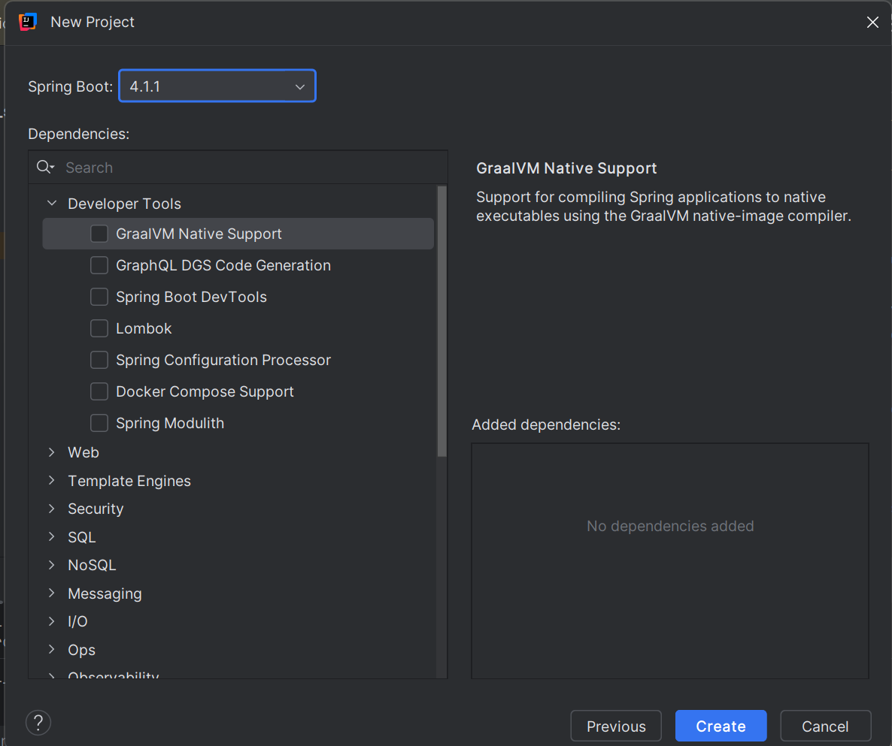 sans aucune depndances et la on va ajoute les microserviec 
1- customer microsrevice :
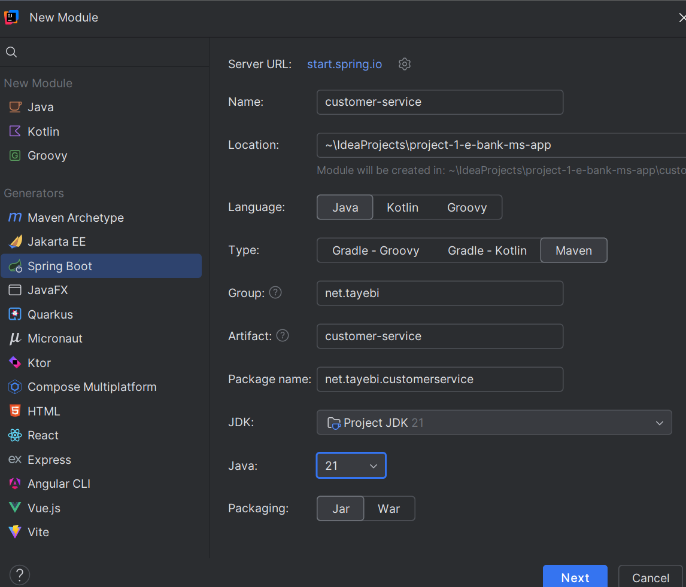
avec depndecies:

spirng web , jpa , h2 db, lombok ,  eureka discovery client qui pemrte au microsrvice de senregitsrer
, checrher config via  config clien t , pusi  actuator pour ts qui est monitoring des microservice 
apres on va ajouter mcp une fois on arrive au chabot part
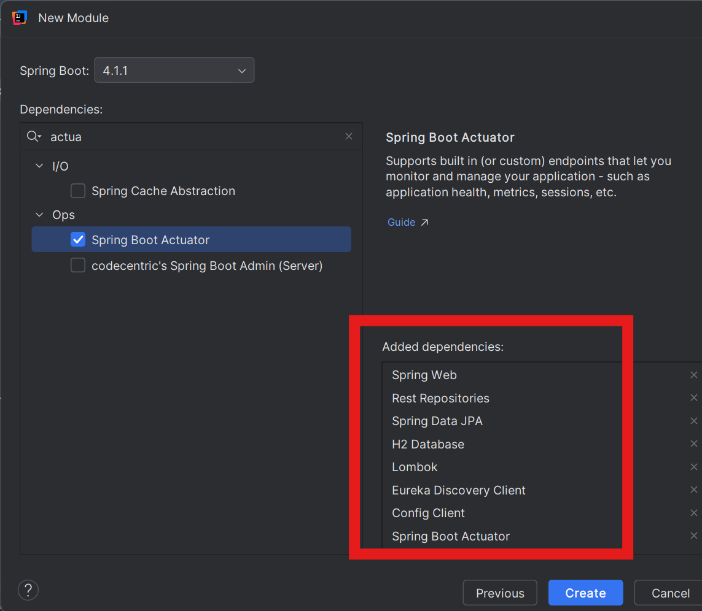
on cere pavkages:
enities:
Customer
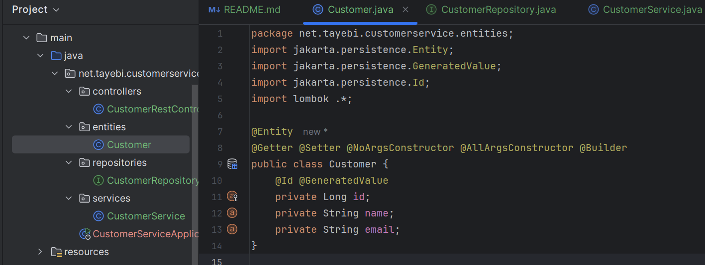
repositories
CustomerRepository
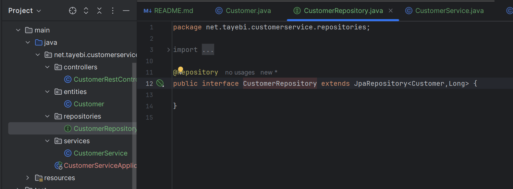
 services
CustomerService
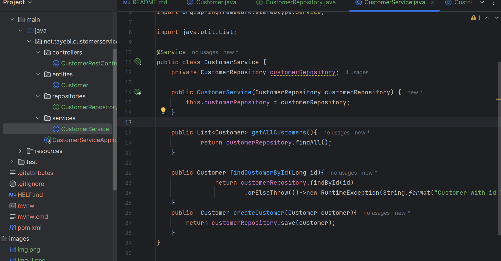
controllers

CustomerController

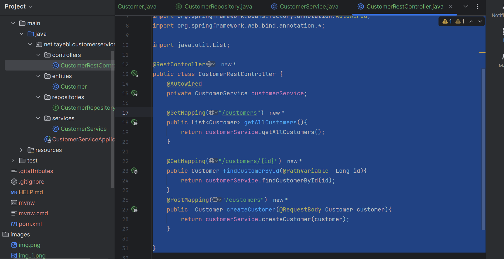
package net.tayebi.customerservice.entities;
import jakarta.persistence.Entity;
import jakarta.persistence.GeneratedValue;
import jakarta.persistence.Id;
import lombok .*;

@Entity
@Getter @Setter @NoArgsConstructor @AllArgsConstructor @Builder
public class Customer {
@Id @GeneratedValue
private Long id;
private String name;
private String email;
}


package net.tayebi.customerservice.repositories;

import jakarta.persistence.Entity;
import jakarta.persistence.GeneratedValue;
import jakarta.persistence.Id;
import lombok.*;
import net.tayebi.customerservice.entities.Customer;
import org.springframework.data.jpa.repository.JpaRepository;
import org.springframework.stereotype.Repository;

@Repository
public interface CustomerRepository extends JpaRepository<Customer,Long> {

}


package net.tayebi.customerservice.services;


import net.tayebi.customerservice.entities.Customer;
import net.tayebi.customerservice.repositories.CustomerRepository;
import org.springframework.stereotype.Service;

import java.util.List;

@Service
public class CustomerService {
private CustomerRepository customerRepository;

    public CustomerService(CustomerRepository customerRepository) {
        this.customerRepository = customerRepository;
    }

    public List<Customer> getAllCustomers(){
            return customerRepository.findAll();
    }

    public Customer findCustomerById(Long id){
                return customerRepository.findById(id)
                        .orElseThrow(()->new RuntimeException(String.format("Customer with id %s not found", id)));
    }
    public  Customer createCustomer(Customer customer){
        return customerRepository.save(customer);
    }
}


package net.tayebi.customerservice.controllers;


import net.tayebi.customerservice.entities.Customer;
import net.tayebi.customerservice.repositories.CustomerRepository;
import net.tayebi.customerservice.services.CustomerService;
import org.springframework.beans.factory.annotation.Autowired;
import org.springframework.web.bind.annotation.*;

import java.util.List;

@RestController
public class CustomerRestController {
@Autowired
private CustomerService customerService;

    @GetMapping("/customers")
    public List<Customer> getAllCustomers(){
        return customerService.getAllCustomers();
    }

    @GetMapping("/customers/{id}")
    public Customer findCustomerById(@PathVariable  Long id){
        return customerService.findCustomerById(id);
    }
    @PostMapping("/customers")
    public  Customer createCustomer(@RequestBody Customer customer){
        return customerService.createCustomer(customer);
    }

}
la on a path vraibale cad le param est dna sle path mas request body cad que lobj est dans le body  pas dans path
@PathVariable → donnée dans l'URL
@RequestBody → donnée dans le corps de la requête

contreler advise : permet de gere les axcepions 
on peu aussi faire des exception handler pour que si ya eception on la prend et on lenvie via http

on passe acree cmd line runner:

on ajoute notr bean qui sert acreer nos customers:
package net.tayebi.customerservice;

import net.tayebi.customerservice.entities.Customer;
import net.tayebi.customerservice.repositories.CustomerRepository;
import net.tayebi.customerservice.services.CustomerService;
import org.springframework.boot.CommandLineRunner;
import org.springframework.boot.SpringApplication;
import org.springframework.boot.autoconfigure.SpringBootApplication;
import org.springframework.context.annotation.Bean;

import java.util.List;

@SpringBootApplication
public class CustomerServiceApplication {

    public static void main(String[] args) {
        SpringApplication.run(CustomerServiceApplication.class, args);
    }
    @Bean
    public CommandLineRunner start(CustomerService customerService) {
        return args -> {
           List<String> names= List.of("siham","imane","omar","ali","fouzia" );
           names.forEach(name -> {
               customerService.createCustomer(
                       Customer.builder()
                               .name(name)
                               .email(name+"@gmail.com")
                               .build()
               );
           });
        };

    }

}
et apr son passe au config 

on descative
spring.cloud.config.discovery.enabled=false
 sinn il va passer a charcher a senrgistrer 
et on descative auss noter config sinn il va chercher un servcie de config centralise 
e donc snotre config
spring.application.name=customer-service
spring.application.name=customer-service
server.port=8056
spring.cloud.config.discovery.enabled=false
spring.cloud.config.enabled=false
eureka.client.enabled=false
spring.datasource.url=jdbc:h2:mem:customers-db
spring.h2.console.enabled=true

on demarre notre app
http://localhost:8056/customers

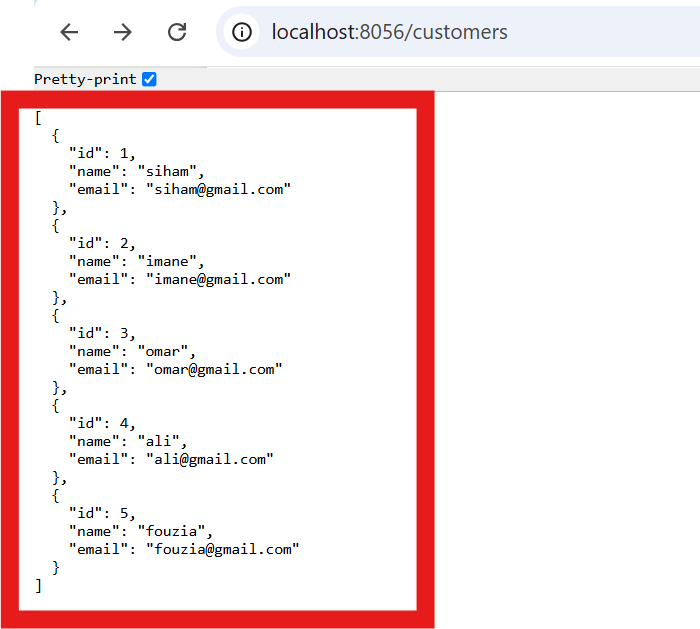
et vpila donc tt nos customers 
on va au bd ss url :
http://localhost:8056/h2-console

e voila ca faiche tt nos cyustomers 
 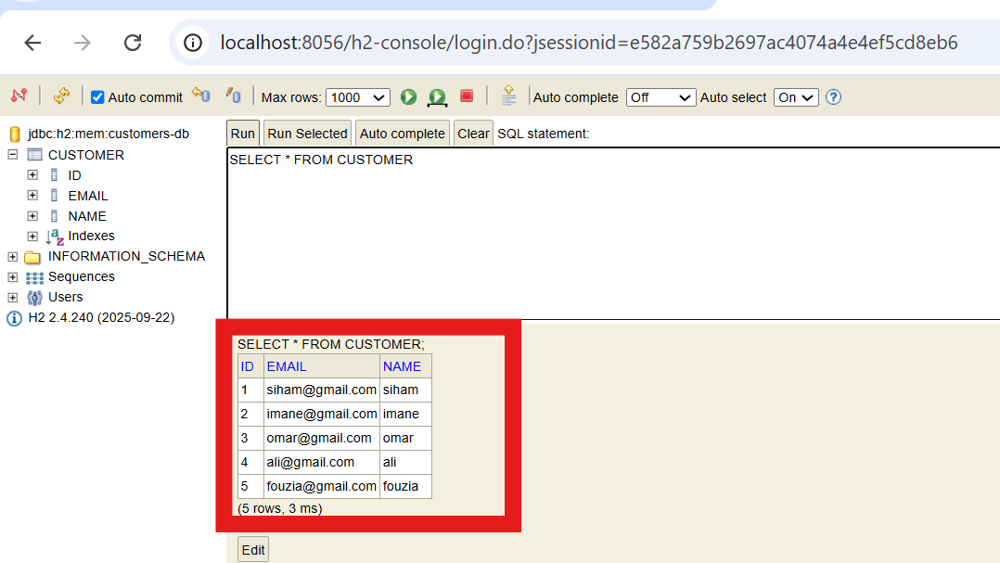

puis pon ajoute notre documentation swagger:
<dependency>
<groupId>org.springdoc</groupId>
<artifactId>springdoc-openapi-starter-webmvc-ui</artifactId>
<version>3.1.1</version>
</dependency>
et voila notre dweb api 
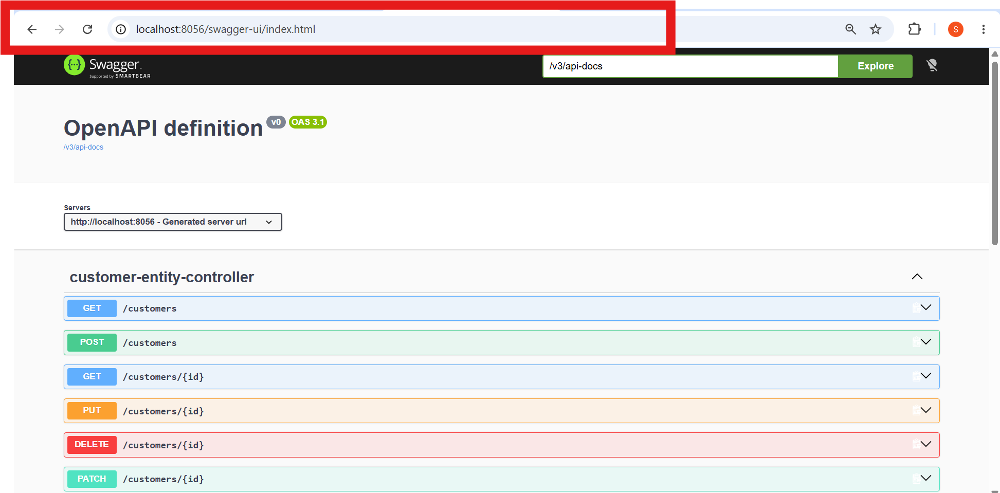
http://localhost:8056/swagger-ui/index.html
on etst les donc
GET
/customers
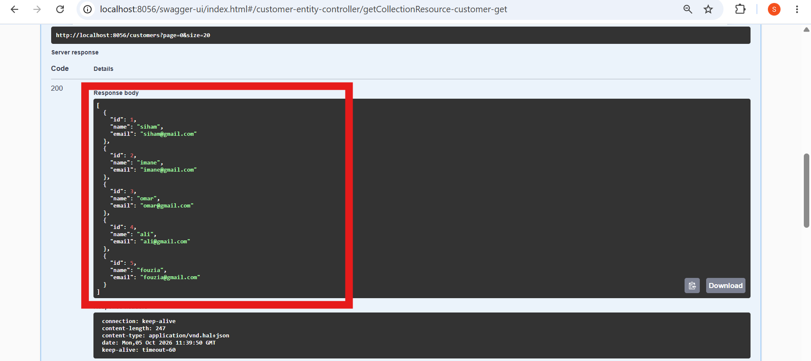


POST
/customers

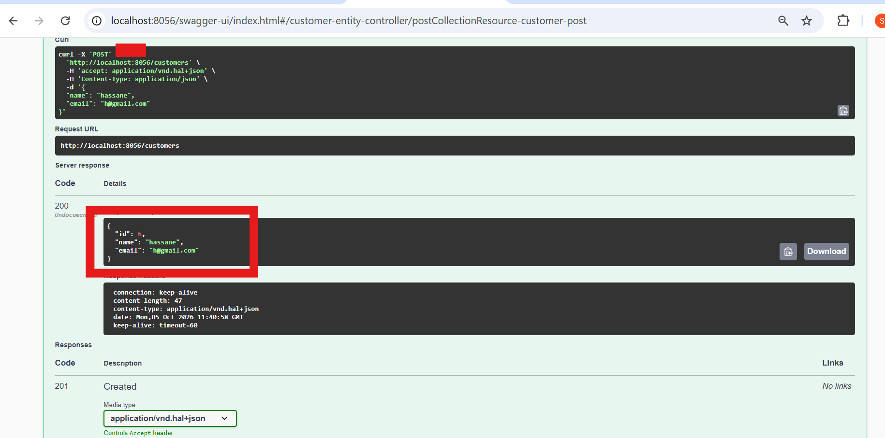

GET
/customers/{id}
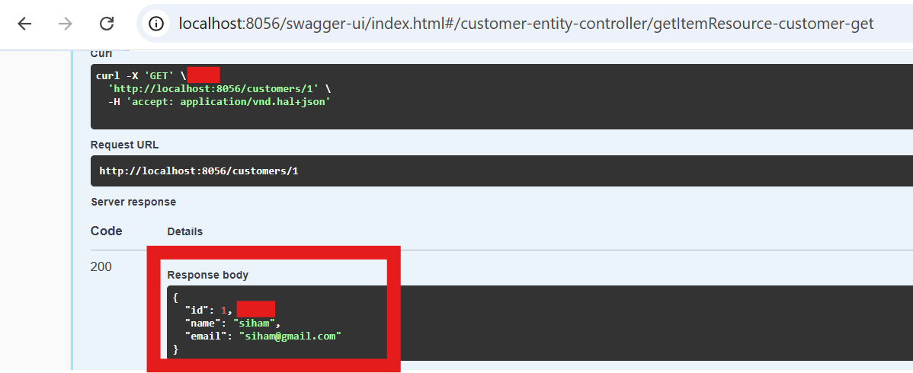
onn pase a creer notre ebank service:
avec el meme dependencies que custoemr service
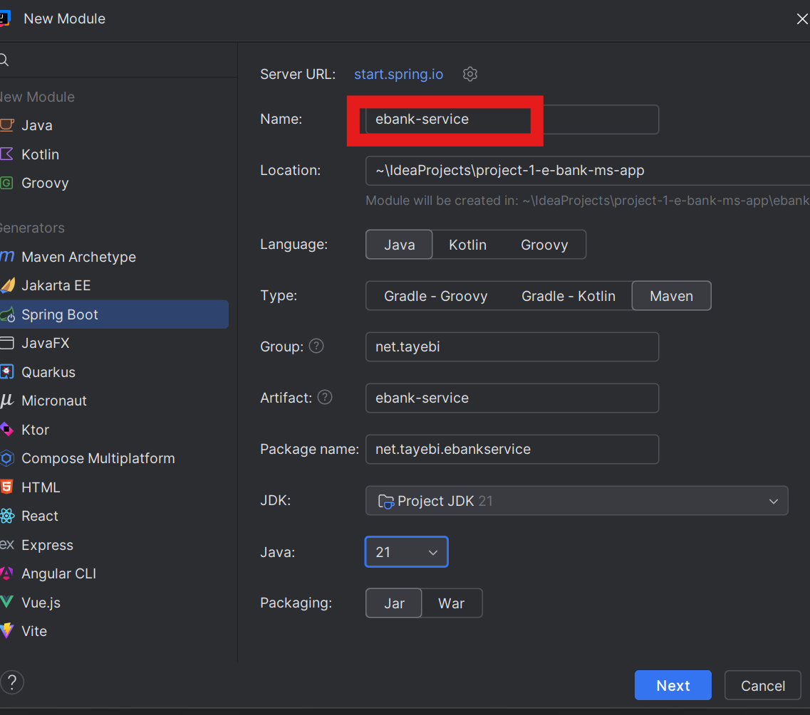
et on jaoute aussie
entities
└── BankAccount

repositories
└── BankAccountRepository

services
└── BankAccountService

controllers
└── BankAccountController
model
|____ Customer


package net.tayebi.ebankservice.services;

import net.tayebi.ebankservice.entities.BankAccount;
import net.tayebi.ebankservice.repositories.BankAccountRepository;
import org.springframework.stereotype.Service;

import java.util.List;

@Service
public class BankAccountService {
private BankAccountRepository accountRepository;

    public BankAccountService(BankAccountRepository accountRepository){
        this.accountRepository = accountRepository;
    }
    public List<BankAccount> getAllBankAccounts(){
        return accountRepository.findAll();
    }

    public BankAccount getBankAccountById(String id){
            return accountRepository.findById(id)
                    .orElseThrow(()->new RuntimeException("Account not found"));
    }

    public BankAccount save(BankAccount bankAccount){
                return accountRepository.save(bankAccount);
    }
}


package net.tayebi.ebankservice.controllers;

import net.tayebi.ebankservice.entities.BankAccount;
import net.tayebi.ebankservice.repositories.BankAccountRepository;
import net.tayebi.ebankservice.services.BankAccountService;
import org.springframework.beans.factory.annotation.Autowired;
import org.springframework.web.bind.annotation.*;

import java.util.List;

@RestController
public class BankAccountController {
@Autowired
private BankAccountService bankAccountService;

    @GetMapping("/accounts")
    public List<BankAccount> getAllBankAccounts(){
        return bankAccountService.getAllBankAccounts();
    }

    @GetMapping("/accounts/{id}")
    public BankAccount getBankAccountById(@PathVariable String id){
        return bankAccountService.getBankAccountById(id);
    }

    @PostMapping("/accounts")
    public BankAccount save(@RequestBody  BankAccount bankAccount){
        return bankAccountService.save(bankAccount);
    }

}


package net.tayebi.ebankservice.entities;

import jakarta.persistence.Id;
import jakarta.persistence.Transient;
import lombok.AllArgsConstructor;
import lombok.Getter;
import lombok.NoArgsConstructor;
import lombok.Setter;
import net.tayebi.ebankservice.model.Customer;

import java.util.Date;

@Getter
@Setter
@NoArgsConstructor
@AllArgsConstructor
public class BankAccount {
@Id
private String id;
private Date createdAt;
private double balance;
private String type;
private long customerId;
@Transient
private Customer customer;
}


package net.tayebi.ebankservice.model;

import lombok.*;

@Getter
@Setter
@NoArgsConstructor
@AllArgsConstructor
@Builder
public class Customer {
private Long id;
private String name;
private String email;
}


package net.tayebi.ebankservice.repositories;

import net.tayebi.ebankservice.entities.BankAccount;
import org.springframework.data.jpa.repository.JpaRepository;

import java.util.List;

public interface BankAccountRepository extends JpaRepository<BankAccount, String> {

    List<BankAccount> findByCustomerId(Long id);
}

on pase dan sbean a se service pour cree rdes acounts

package net.tayebi.ebankservice;

import net.tayebi.ebankservice.entities.BankAccount;
import net.tayebi.ebankservice.repositories.BankAccountRepository;
import net.tayebi.ebankservice.services.BankAccountService;
import org.springframework.boot.CommandLineRunner;
import org.springframework.boot.SpringApplication;
import org.springframework.boot.autoconfigure.SpringBootApplication;
import org.springframework.context.annotation.Bean;

@SpringBootApplication
public class EbankServiceApplication {

	public static void main(String[] args) {
		SpringApplication.run(EbankServiceApplication.class, args);
	}

	@Bean
	CommandLineRunner init(BankAccountService bankAccountService) {
		return args -> {
			for (int i = 1; i <= 3; i++) {
				for (int j = 0; j <5 ; j++) {
					bankAccountService.save(
							BankAccount.builder()
							. type (Math.random()>0.5? "CURRENT-ACCOUNT": "SAVING_ACCOUNT")
									.balance(1000+ Math.random()*60000)
									.customerId(i)
									.build());
				}
		};

	}

}

on pase au config de cet app ou de c microservice


spring.application.name=ebank-service
server.port=8057
eureka.client.enabled=false
spring.cloud.config.enabled=false
spring.cloud.discovery.enabled=false
spring.h2.console.enabled=true
on execute le donc
on tetste

avnmat on ajoute aussi de swagger
<dependency>
<groupId>org.springdoc</groupId>
<artifactId>springdoc-openapi-starter-webmvc-ui</artifactId>
<version>3.1.1</version>
</dependency>
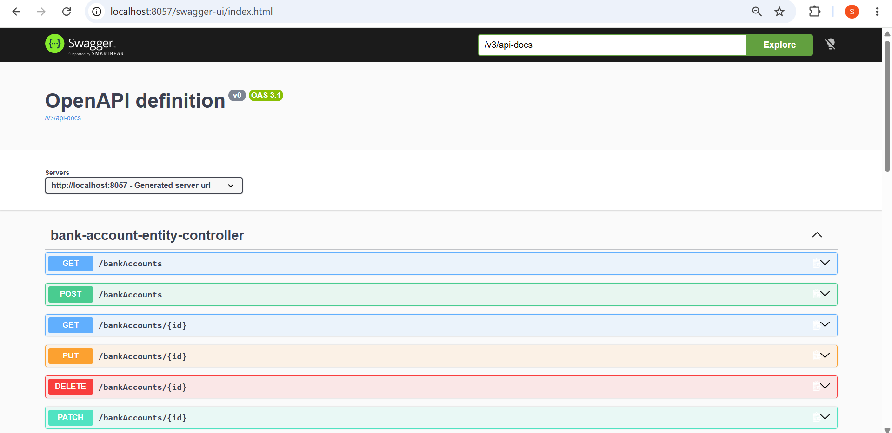
o ntets notre api domcn 
test gde get all 
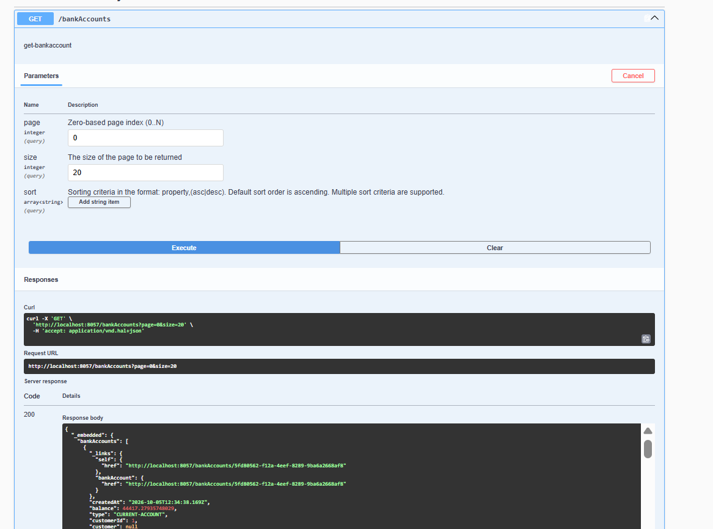

get by id 
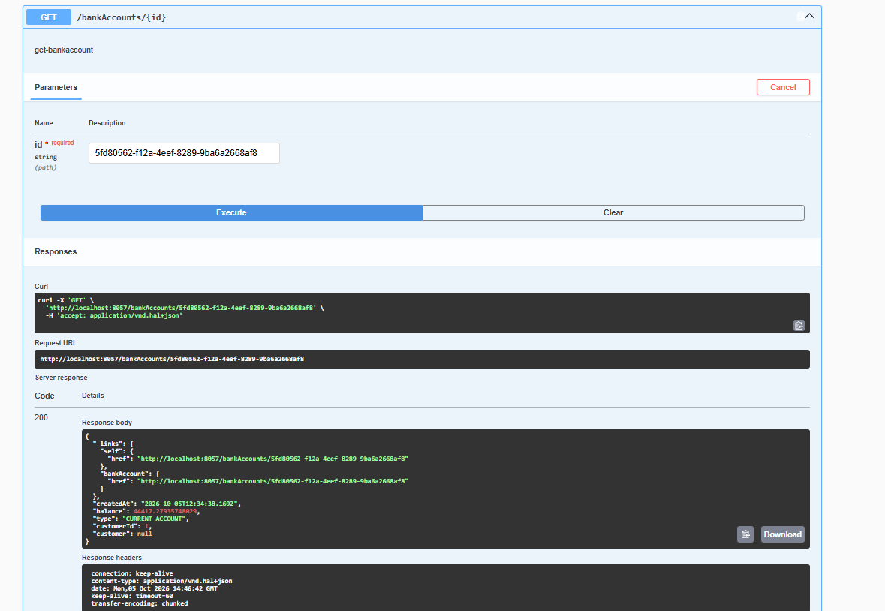

on passe a creer notre gaway service: avc depnednecies:
reactive gateway, discovery clin, actuiator

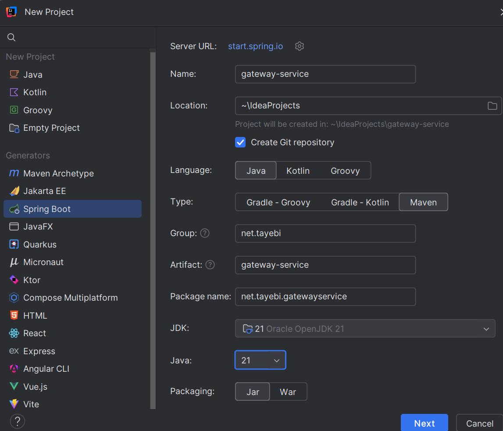


Pour rutage statique on utulsie sfiche de config .yaml

ca c rouage stattique:
spring:
cloud:
gateway:
server:
webflux:
routes:
- id : r1
uri: http://localhost:8056
predicates:
- Path= /customers/**
- id: r2
uri: http://localhost:8057
predicates:
- Path= /accounts/**


on passe au config de la gateway et ondesacive eureka pcq c pas encore cree
et voila donc an tetsr 
ca nmarche  http://localhost:9999/customers
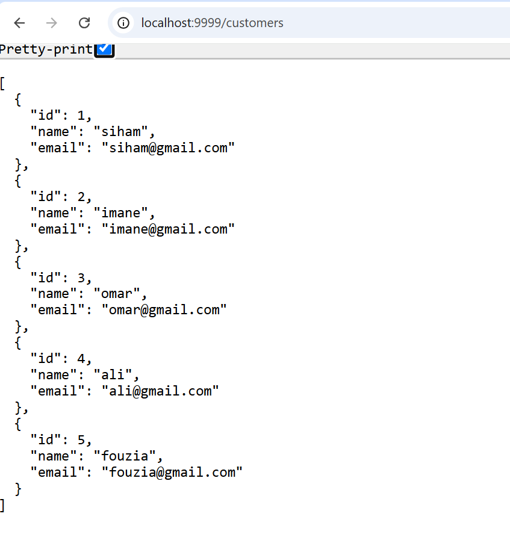


et aussi  ca marche : http://localhost:9999/accounts
 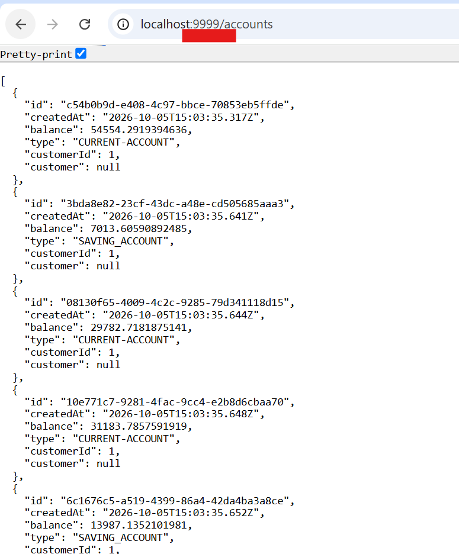

ca sc rouage sttaiuqe onpasse acrrer notre discprvey service
avec depndencies:
eureka servcer,actuator
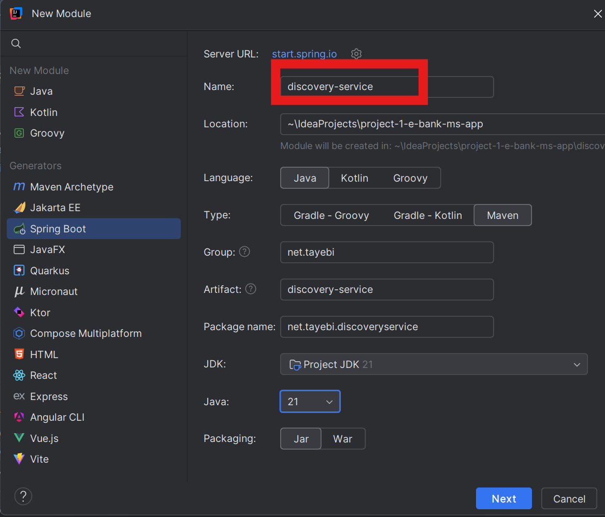

avec port 8761
spring.application.name=discovery-service
server.port=8761
on desacive donc fetch registry et register  car  sui on les active une fosi elle demarr eil vont cherche a senresgistetr et c pas utilsie
spring.application.name=discovery-service
server.port=8761
eureka.client.fetch-registry=false
eureka.client.register-with-eureka=false
on enbale eureka server sinn ca va pas marche
package net.tayebi.discoveryservice;
import org.springframework.boot.SpringApplication;
import org.springframework.boot.autoconfigure.SpringBootApplication;
import org.springframework.cloud.netflix.eureka.server.EnableEurekaServer;

@SpringBootApplication
@EnableEurekaServer
public class DiscoveryServiceApplication {

	public static void main(String[] args) {
		SpringApplication.run(DiscoveryServiceApplication.class, args);
	}

}

on exec et c bn pur lurl ca marhce
http://localhost:8761/
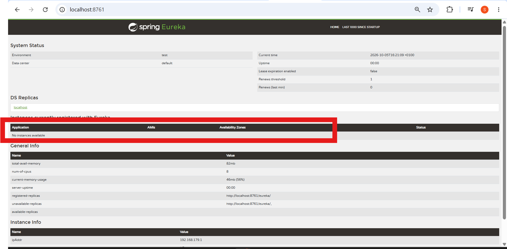


pour le moememn aucun service  nes t uenregistre pour se faire on reveient a leur config et on  active discovery
dan amain sicovery sevrice :
avec
spring.cloud.config.discovery.enabled=true // pour toruvr ma ip contac eureka
eureka.client.enabled=true //je veux utilsier euraka pour snenrgeizter


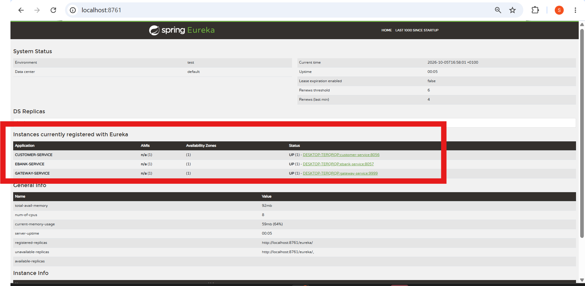

maintnenn on doi etablir un communictaion entre scutsem r svrice et bank via open feign  dans nore ebnak-service
<dependency>
<groupId>org.springframework.cloud</groupId>
<artifactId>spring-cloud-starter-netflix-eureka-client</artifactId>
</dependency>
pis on ajoute repo feign dna sebank service
<dependency>
<groupId>org.springframework.cloud</groupId>
<artifactId>spring-cloud-starter-openfeign</artifactId>
</dependency>

package net.tayebi.ebankservice.feign;

import net.tayebi.ebankservice.model.Customer;
import org.springframework.cloud.openfeign.FeignClient;
import org.springframework.web.bind.annotation.GetMapping;
import org.springframework.web.bind.annotation.PathVariable;

@FeignClient(name = "customer-service")
public interface CustomerRestClient {
@GetMapping("/customers/{id}")
public Customer getCustomer(@PathVariable int id) ;
}

ici envoi req avc id puis recucper le et le stcoke dans obj cusotmer cree et pur que ca amrhc efaut beosi  d config sys de routage de maniere dynamiqu n meemtnan app/yaml en comemnt et creer les anotaion
via meth reactive dscovery cleint dans gateway
package net.tayebi.gatewayservice;

import com.netflix.discovery.DiscoveryClient;
import org.springframework.boot.SpringApplication;
import org.springframework.boot.autoconfigure.SpringBootApplication;
import org.springframework.boot.web.server.autoconfigure.ServerProperties;
import org.springframework.cloud.client.discovery.ReactiveDiscoveryClient;
import org.springframework.cloud.gateway.discovery.DiscoveryClientRouteDefinitionLocator;
import org.springframework.cloud.gateway.discovery.DiscoveryLocatorProperties;
import org.springframework.context.annotation.Bean;

@SpringBootApplication
public class GatewayServiceApplication {

	public static void main(String[] args) {
		SpringApplication.run(GatewayServiceApplication.class, args);
	}
	@Bean
	DiscoveryClientRouteDefinitionLocator routes(ReactiveDiscoveryClient rdc, DiscoveryLocatorProperties dlp) {
		return new DiscoveryClientRouteDefinitionLocator(rdc, dlp);
	}

}
 et on redemmarre
geatweay et donc si on met ca va marhce http://localhost:9999/accounts 
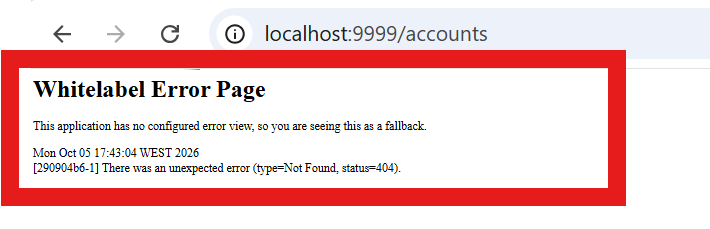
on doit metr enom de sevcie commeca avec nom servcie majuscul acr defau  cenrgsier dna sdiscoveyr en majuscule
http://localhost:9999/EBANK-SERVICE/accounts
et camache
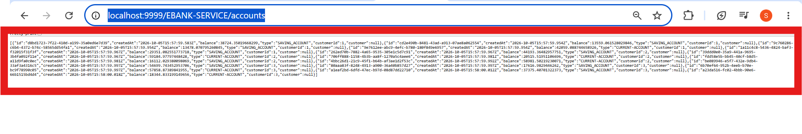

http://localhost:9999/CUSTOMER-SERVICE/customers
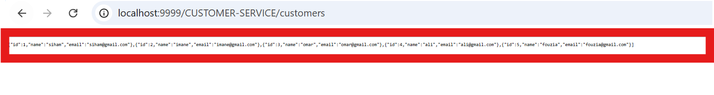
on va au sevrie de ebnak et on essya ede recucu e customer vai noe res client mehods
pour que je peux ajouer bean objr dan smon sevic eje dois fair e
@EnableFeignClients
dans main puis je peux fiar
package net.tayebi.ebankservice.services;

import lombok.AllArgsConstructor;
import net.tayebi.ebankservice.entities.BankAccount;
import net.tayebi.ebankservice.feign.CustomerRestClient;
import net.tayebi.ebankservice.repositories.BankAccountRepository;
import org.springframework.beans.factory.annotation.Autowired;
import org.springframework.stereotype.Service;

import java.util.Date;
import java.util.List;
import java.util.UUID;

@Service
@AllArgsConstructor

public class BankAccountService {

    private BankAccountRepository accountRepository;
    private CustomerRestClient customerRestClient;

    public List<BankAccount> getAllBankAccounts(){
        return accountRepository.findAll();
    }

    public BankAccount getBankAccountById(String id){
            BankAccount bankAccount= accountRepository.findById(id)
                    .orElseThrow(()->new RuntimeException("Account not found"));
            bankAccount.setCustomer(customerRestClient.getCustomer(bankAccount.getCustomerId()));
        return bankAccount;
    }

    public BankAccount save(BankAccount bankAccount){
                bankAccount.setId(UUID.randomUUID().toString());
                bankAccount.setCreatedAt(new Date());
                return accountRepository.save(bankAccount);
    }
}

on test ebank open feign cerre un clien  rets de mnaier edecalraive
enable feign cleint c pour auoiser linjceion dna ses client
c bon ca mrcenbien http://localhost:9999/EBANK-SERVICE/accounts/63123a42-365a-4616-9684-6ba57e741a8c
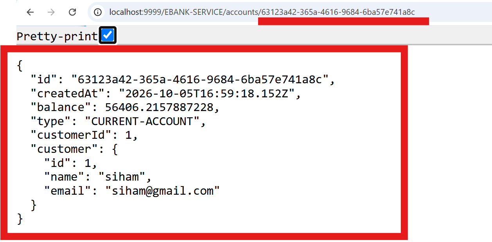
la on a co mpte avec ebank servcie  avec info de customer a laide de cusomer sevrce
la on apsse a on peut peas enrgster un acocut  si aps de iuser cusomer
public BankAccount save(BankAccount bankAccount){
try {
Customer customer = customerRestClient.getCustomer(bankAccount.getCustomerId());
bankAccount.setId(UUID.randomUUID().toString());
bankAccount.setCreatedAt(new Date());
return accountRepository.save(bankAccount);

        } catch (RuntimeException e) {
            throw new RuntimeException(e.getMessage());
        }
    }
}
c a nosu de gere les rreles dintegerite refrernetiel
la on va utilsie ror four tlerance rsilence 4 j pour resoudre prob tolerance au panne
on ejoute dep resilen 4 j et ciruit breaker pour que si srvice n ps dispo 
on ajoute circuit breaker pour les meth qui peuvtne genrer des excpetion pour le diirger vrs defiual  meth for exmple
package net.tayebi.ebankservice.feign;

import io.github.resilience4j.circuitbreaker.annotation.CircuitBreaker;
import net.tayebi.ebankservice.model.Customer;
import org.springframework.cloud.openfeign.FeignClient;
import org.springframework.web.bind.annotation.GetMapping;
import org.springframework.web.bind.annotation.PathVariable;

@FeignClient(name = "customer-service")

public interface CustomerRestClient {
@GetMapping("/customers/{id}")
@CircuitBreaker(name = "customer-service",fallbackMethod = "defaultCustomerMethod")
public Customer getCustomer(@PathVariable long id) ;
default  Customer defaultCustomerMethod(Exception e, Long id) {
return new Customer(id,"Default name","default@gmail.com");

    }
}

on teste par arreter couomr servcie pour voir ce uqil va afiche 
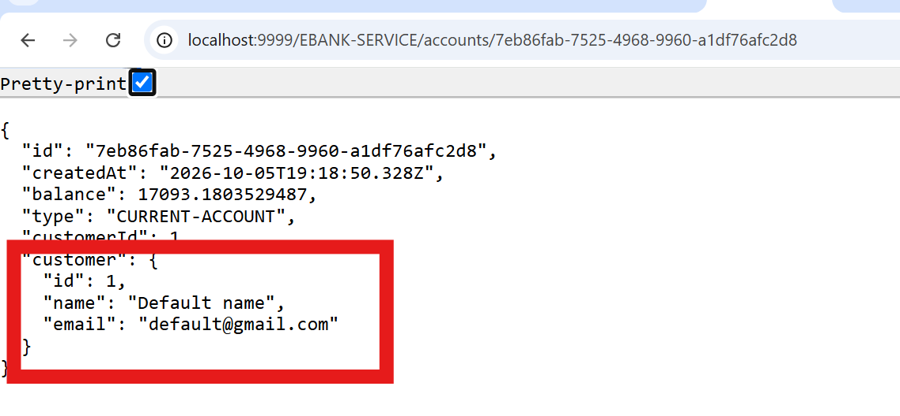
 la on defaults car servcie cutomer arrete
on le realumeet a macreh
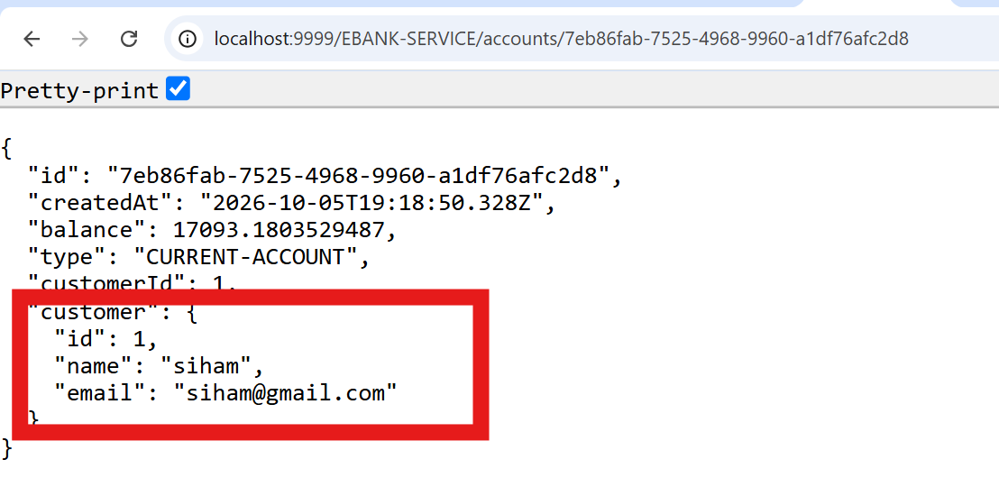
PARTIE 2:ON PASSE A LA CREATION DU CHATBOT  AVEC MCP


on apsse creer chatbot -srvice ou ebank-bot avec dependansces : web , openai comme llm,
ou ollama ou gmeini ms on utlsie que openai maitnnent
et erueka dsicoveru client et config client pusi actuator
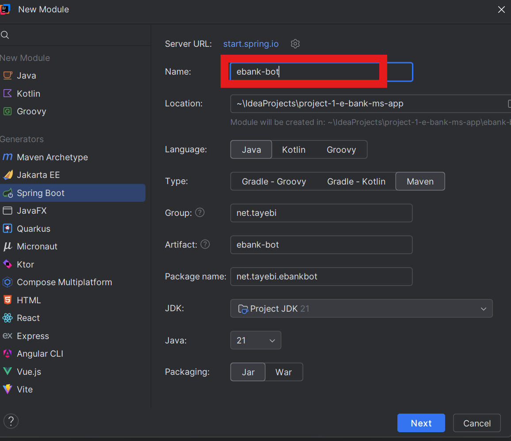

spring.application.name=ebank-bot
spring.ai.openai.chat.options.model=gpt-4o
spring.cloud.discovery.enabled=true
spring.cloud.config.enabled=false

pour comminuqe avec openai on aura besoin de cle open ai api key


on cree contorlelr et chabot controller et on le memet:

server.port=8088

[//]: # (PARIE3;ET FROBTEND ANGULAR AVC CLIENT TLEGRAM)

[//]: # (APRES SECURITE AVEC KEKLCOCK ETC)
on intnene dependnency swagger

et voila on fait req dna surl c quoi amrakech ca repond
http://localhost:8088/chat?query=c%27quoi%20marakech
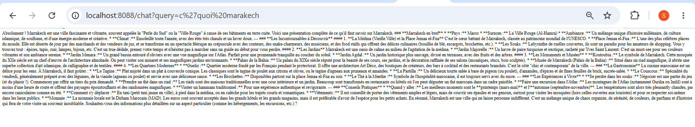
test de  cet:http://localhost:8088/swagger-ui/index.html#/ebank-chatbot-controller/chat  
GET
/chat
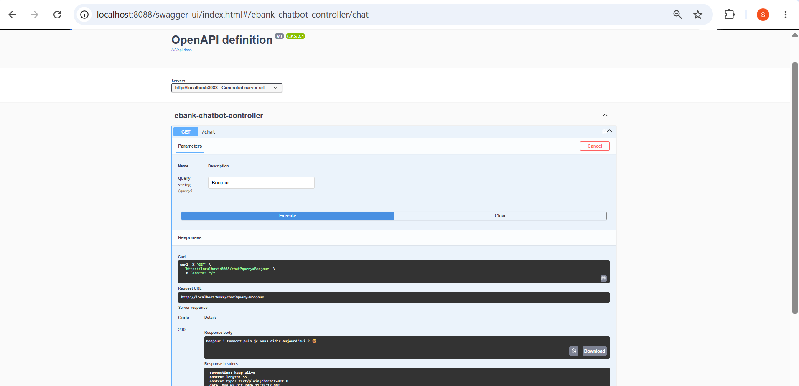


ca me repodn  jai ditt bonjour eeil dit bnoju comemen je peux taidr docn c bon on teste comem on siat il sotn stateless cad aps de memeory je leui dit me nom et je lui ask apres pour svaoir suil le reppale
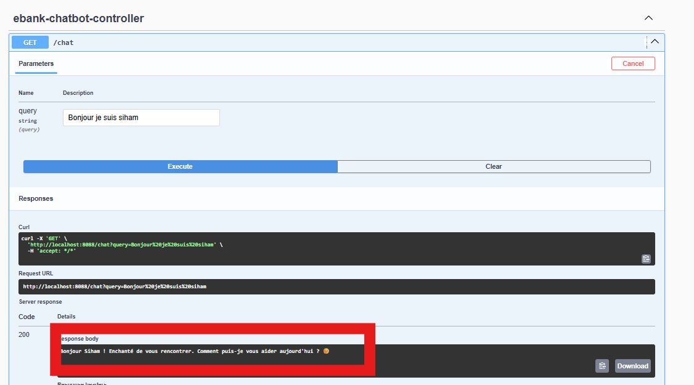
il dit quil ne me coananit pas ca rya pas de memepir
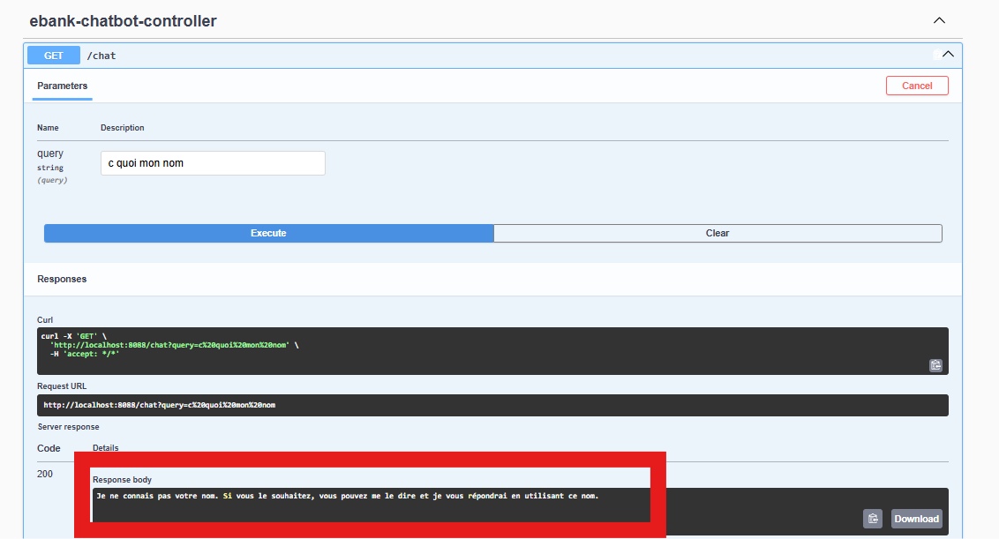
et c ca ce quon va fiare en injectnat chat memory
public EbankChatbotController(ChatClient.Builder chatClient, ChatMemory chatMemory) {
this.chatClient = chatClient
.defaultAdvisors(MessageChatMemoryAdvisor.builder(chatMemory).build())
.build();
} la on a consturit eganet avec mmeoire pour gerder les reponse e qst en memeoire pour meoriser 
e n esyae lde lui dire je suis siham et apres c quoi on nom

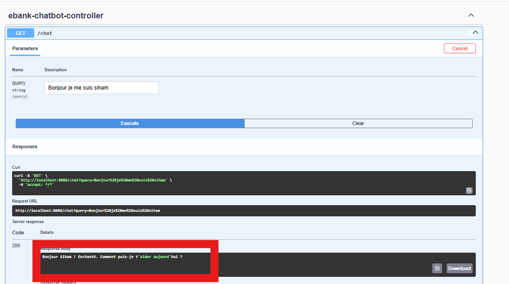
op pase au reel ca c juste test on cree ebank agent:
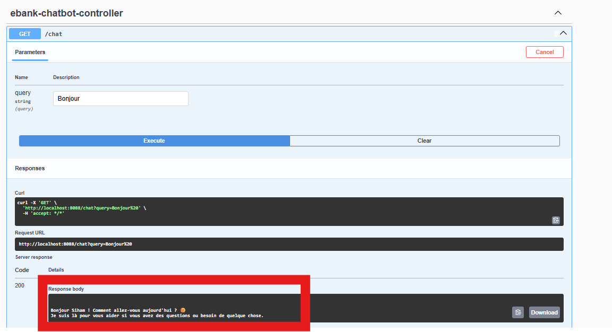

package net.tayebi.ebankbot.controllers;

import org.springframework.ai.chat.client.ChatClient;
import org.springframework.ai.chat.client.advisor.MessageChatMemoryAdvisor;
import org.springframework.ai.chat.memory.ChatMemory;
import org.springframework.stereotype.Service;
import org.springframework.web.bind.annotation.GetMapping;
import org.springframework.web.bind.annotation.RequestParam;
import org.springframework.web.bind.annotation.RestController;

@Service
public class EbankAIAgent {

    private ChatClient chatClient;

    public EbankAIAgent(ChatClient.Builder chatClient, ChatMemory chatMemory) {
        this.chatClient = chatClient
                .defaultAdvisors(
                        MessageChatMemoryAdvisor.builder(chatMemory).build()
                )
                .build();
    }

    public String chat( String query) {

        return chatClient
                .prompt()
                .user(query)
                .advisors(a -> a.param(
                        ChatMemory.CONVERSATION_ID,
                        "user-1"
                ))
                .call()
                .content();
    }
}
package net.tayebi.ebankbot.controllers;

import org.springframework.ai.chat.client.ChatClient;
import org.springframework.ai.chat.client.advisor.MessageChatMemoryAdvisor;
import org.springframework.ai.chat.memory.ChatMemory;
import org.springframework.web.bind.annotation.GetMapping;
import org.springframework.web.bind.annotation.RequestParam;
import org.springframework.web.bind.annotation.RestController;

@RestController
@AllArgsConstructor
public class EbankChatbotController {

    private EbankAIAgent ebankAIAgent;


    @GetMapping("/chat")
    public String chat(
            @RequestParam(name = "query", defaultValue = "Bonjour") String query) {

        return ebankAIAgent.chat(query);
    }


}
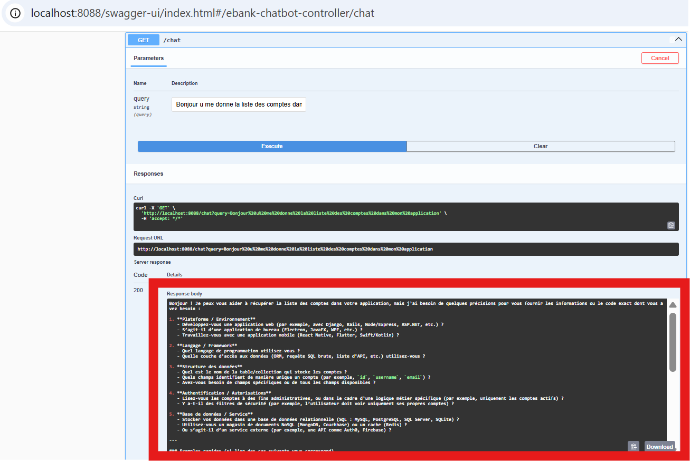 mais il en conanit pas mes donnes de lapp pour le moemn
on passe a utilsier lmcp pour exposer microservcie via mvcp
dans customer svcie on veux uajouter dpennednace mcp serve

et dona csutomer servcie on met mcp tool :

package net.tayebi.customerservice.services;


import net.tayebi.customerservice.entities.Customer;
import net.tayebi.customerservice.repositories.CustomerRepository;
import org.springframework.ai.mcp.annotation.McpTool;
import org.springframework.ai.mcp.annotation.McpToolParam;
import org.springframework.stereotype.Service;

import java.util.List;

@Service
public class CustomerService {
private CustomerRepository customerRepository;

    public CustomerService(CustomerRepository customerRepository) {
        this.customerRepository = customerRepository;
    }
    @McpTool(description = "Get All customers")
    public List<Customer> getAllCustomers(){
            return customerRepository.findAll();
    }

    @McpTool(description = "Find Customer By id")
    public Customer findCustomerById(@McpToolParam(description = "The customer id") Long id){
                return customerRepository.findById(id)
                        .orElseThrow(()->new RuntimeException(String.format("Customer with id %s not found", id)));
    }

    @McpTool(description = "Save Customer")
    public  Customer createCustomer(@McpToolParam(description = "The customer to save(name,email)") Customer customer){
        return customerRepository.save(customer);
    }
}

donc ces meth la sont accessible vvia mcp cad nimporte quelle agent qui connait ladress de ce sevrice peut utilsier dces tools
on va  au config de ce servcie et on met protocol stremable acar il eprmemt de fiare com bidirec entre agent et tools
spring.ai.mcp.server.protocol=streamable

si on a client mcp ca peut se connecter auto avce ce servcie la comem postman ou inspector mcp
on tst avec inspector
ca c client mcp
npx run @modelcontextprotocol/inspector

ou bein on test avec postman meiux
ms on va le tester apres
on reveint vers chatbot poru csbpoi comemnt il va lutiser ce serve rmcp
dna sebnak bot on jaoute mcp cleint
puis on config
spring.ai.mcp.client.streamable-http.connections.customer.url=http://localhost:8056/mcp
 
car par defgaut c depose dna snedpoitn /mcp
aon dit anotre agent de cherge tools au demarrage en injecttan tollclaback provider dna scisntruceur
on demande donc dans notre endpoitns liste de lxitns etvila c affiche avec cee qst Bonjour u me donne la liste des clients
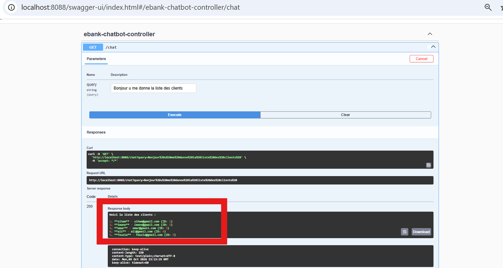
stp tu me donne les details du client 2 ca donne details 
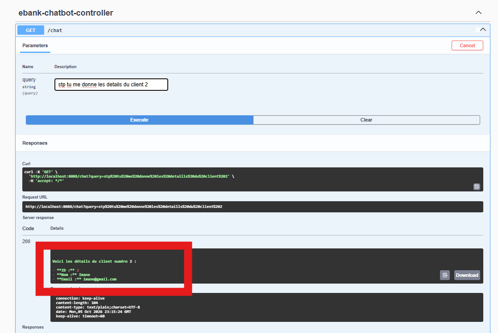

si on met  
ca repond mais nous ondoit  limmiter le champs dacitivte
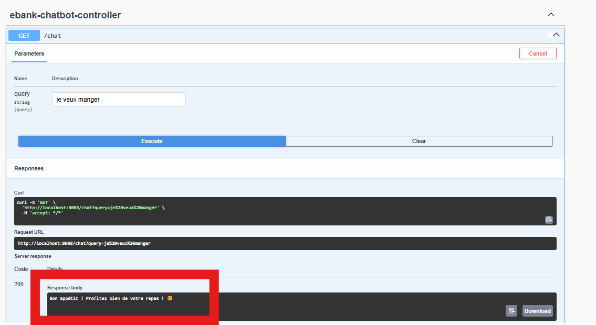
on ajoute ca pour delimieter le champs dactivite
.defaultSystem("Vous un assistant qui se charge de répondre aux question" +
" de l'utilisateur en fonction du contexte fourni ,si aucun contexte " +
"n'est fourni, répond avec JE NE SAIS PAS"
)
voila la il repodn avc je ne sais pas sur je veux amnger
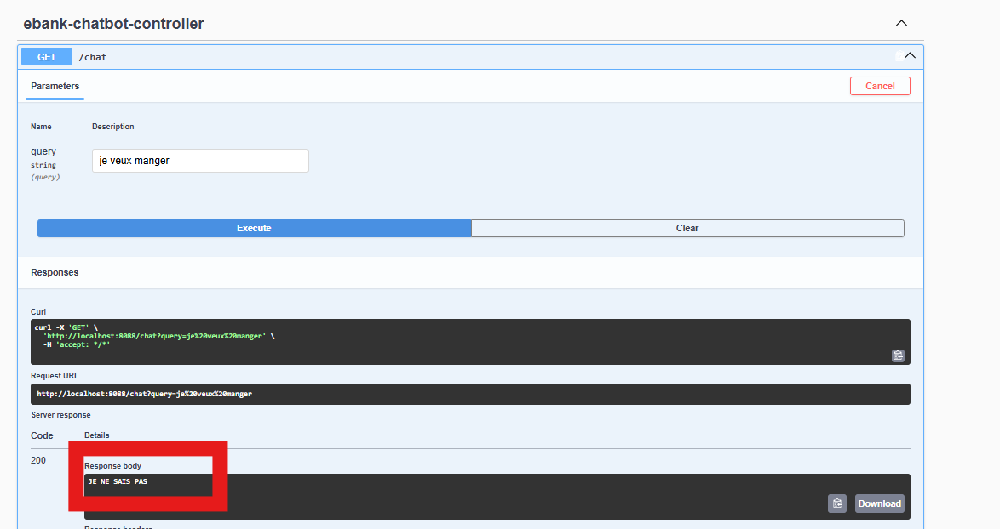
liste de sclients ca repond:
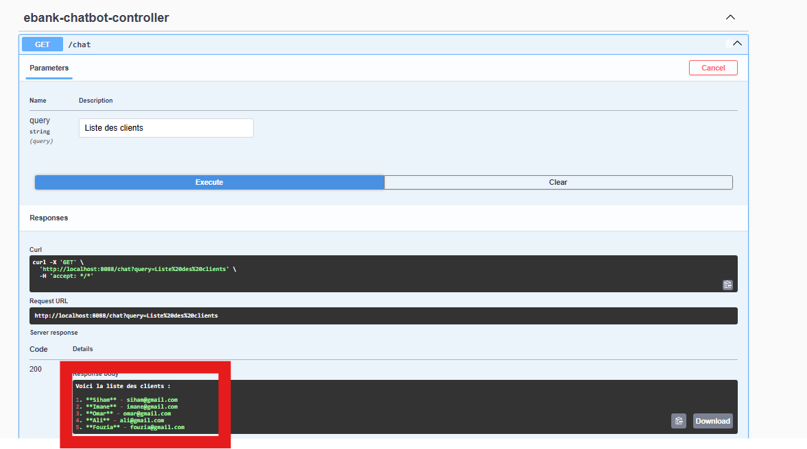

on rfait meme chsoe pour accounts
<dependency>
<groupId>org.springframework.ai</groupId>
<artifactId>spring-ai-starter-mcp-server-webmvc</artifactId>
</dependency>
on passe a mettre not annotation tools ou bein definri nos tools
dan sprroop ebankserbvice :
spring.ai.mcp.server.protocol=streamable

pusi modif dna ssevice
package net.tayebi.ebankservice.services;

import lombok.AllArgsConstructor;
import net.tayebi.ebankservice.entities.BankAccount;
import net.tayebi.ebankservice.feign.CustomerRestClient;
import net.tayebi.ebankservice.model.Customer;
import net.tayebi.ebankservice.repositories.BankAccountRepository;
import org.springframework.ai.mcp.annotation.McpTool;
import org.springframework.ai.mcp.annotation.McpToolParam;
import org.springframework.beans.factory.annotation.Autowired;
import org.springframework.stereotype.Service;

import java.util.Date;
import java.util.List;
import java.util.UUID;

@Service
@AllArgsConstructor

public class BankAccountService {

    private BankAccountRepository accountRepository;
    private CustomerRestClient customerRestClient;

    @McpTool(description = "Get All Bank accounts")
    public List<BankAccount> getAllBankAccounts(){
        return accountRepository.findAll();
    }

    @McpTool(description = "Find Account By Id")
    public BankAccount getBankAccountById(@McpToolParam(description = "The account id") String id){
            BankAccount bankAccount= accountRepository.findById(id)
                    .orElseThrow(()->new RuntimeException("Account not found"));
            bankAccount.setCustomer(customerRestClient.getCustomer(bankAccount.getCustomerId()));
        return bankAccount;
    }

    @McpTool(description = "Save new account")
    public BankAccount save(@McpToolParam(description = "The bank account to save(balance, type, customerId)") BankAccount bankAccount){
        try {
            Customer customer = customerRestClient.getCustomer(bankAccount.getCustomerId());
            bankAccount.setId(UUID.randomUUID().toString());
            bankAccount.setCreatedAt(new Date());
            return accountRepository.save(bankAccount);
            
        } catch (RuntimeException e) {
            throw new RuntimeException(e.getMessage());
        }
    }
}


et ob va  anotre chatbo et on va ajouter autre ligne pourr lautre mcp serve
on va donc a notre benas sevcie pour ajouter leaute mcp servev
spring.ai.mcp.client.streamable-http.connections.ebank.url=http://localhost:8057/mcp
 on c a tter dna snotre web sevrice
on dmemnad liste des cmptres
:
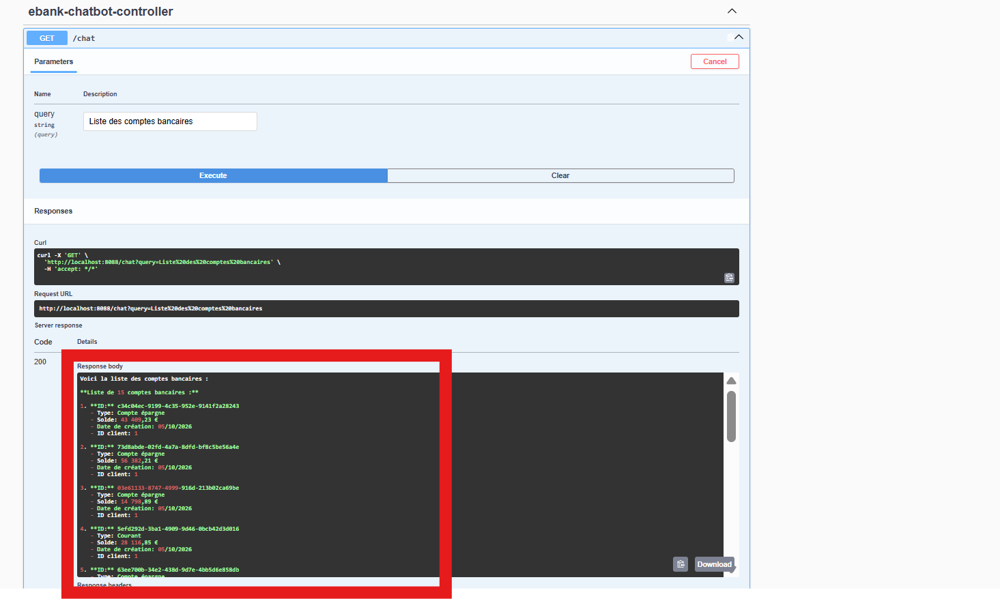

liste des comptes des clients dont id 1
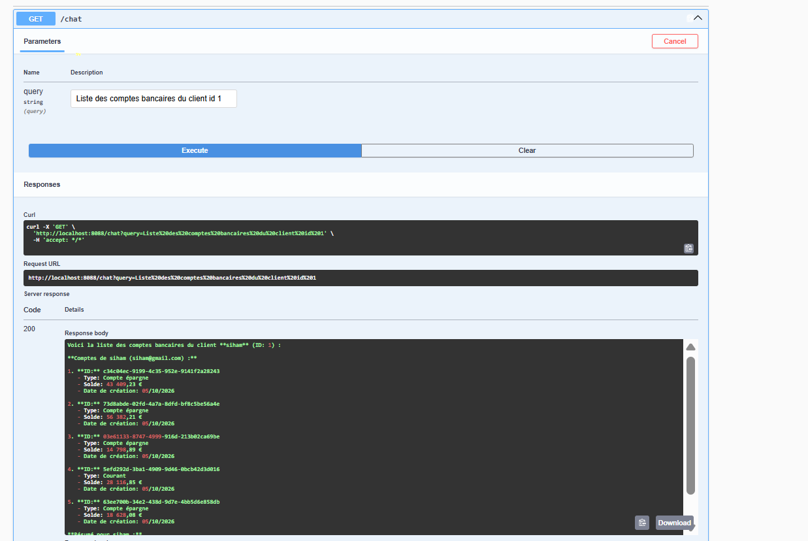


affiche ss forme tab:
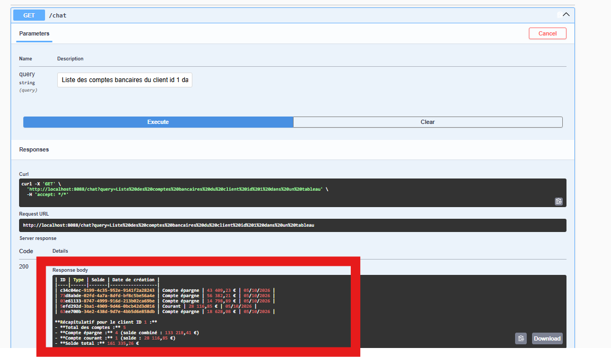

ajouter un nv compte avec infos: ajoute un compte avec type : saving_account,balance:8000, et cusotmerId:2
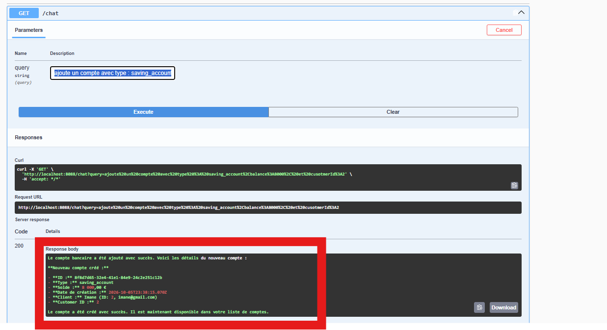
et voila c bien ajoute avec succes
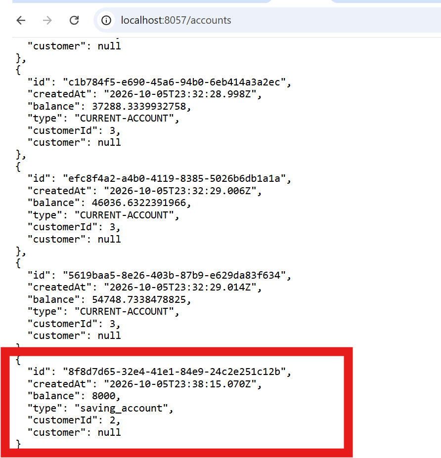
on etster depusi la gateway  http://localhost:9999/EBANK-BOT/chat?query=liste%20des%20comptes
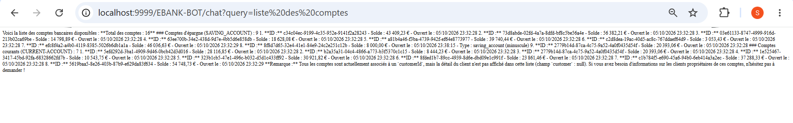

mais reposne comem html ca doit etre affiche stuructue pour se faire on emt
@GetMapping(value = "/chat", produces = MediaType.TEXT_PLAIN_VALUE)
c bon laffiche maintnen ....
http://localhost:9999/EBANK-BOT/chat?query=liste%20des%20comptes
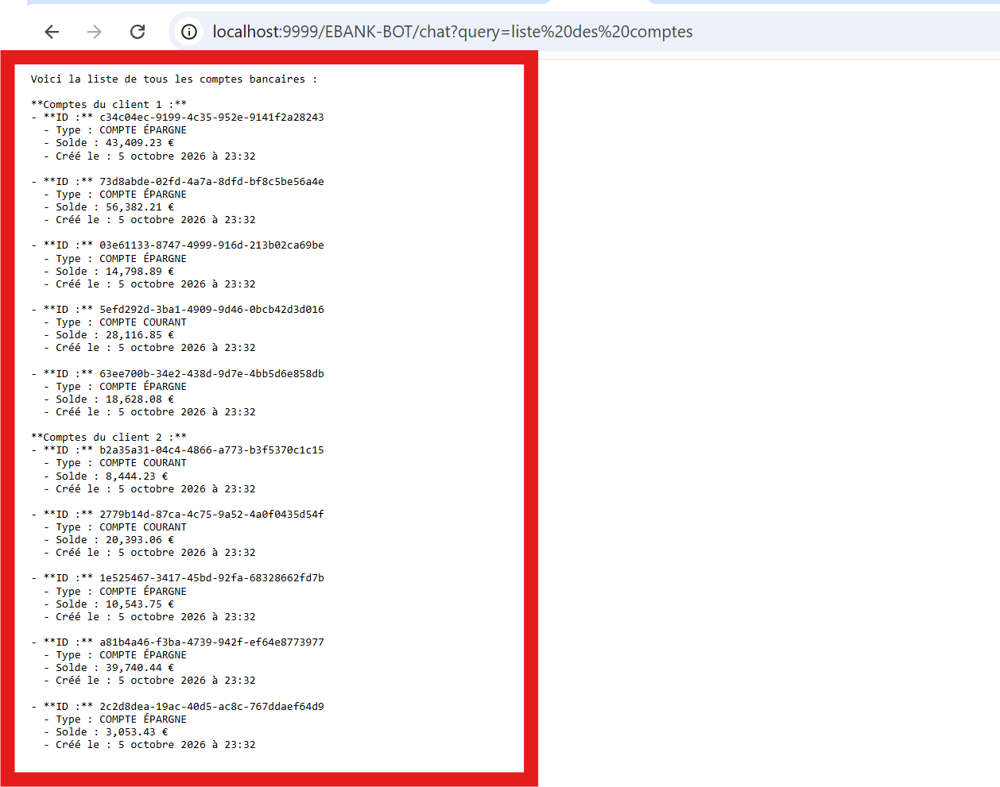

lsite client  http://localhost:9999/EBANK-BOT/chat?query=liste%20des%20clients
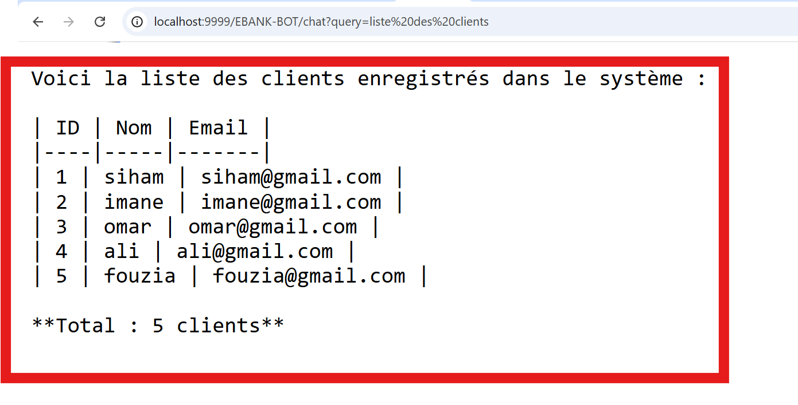

pour les app clients
maintennt on va ezsyae de pemmetre de communique  avec client telegram et cleint dispcord
cad communiuqe avec mon bot vai app tlegram ou dicscord 
pour se fiare on ajoute un dependances
<dependency>
<groupId>org.telegram</groupId>
<artifactId>telegrambots-spring-boot-starter</artifactId>
<version>6.9.7.1</version>
</dependency>

<dependency>
<groupId>com.zgamelogic</groupId>
<artifactId>spring-boot-starter-discord</artifactId>
<version>5.0.4</version>
</dependency>

telegrma cree prob avec ureka c pour cle aonntaville discord et apres tlegram
on cree discord puis DiscordBot
meth perodfm est invoque a chaue foit cleint discord envoie msg
si bot lui meme on traite pas msg ms sinn on traite pour eviter de triater nbcp de msg qui neveint qps de cleint discord

package net.tayebi.ebankbot.discord;

import com.zgamelogic.discord.annotations.DiscordMapping;
import net.dv8tion.jda.api.events.message.MessageReceivedEvent;
import net.tayebi.ebankbot.controllers.EbankAIAgent;

public class DiscordBot {
private EbankAIAgent ebankAIAgent;
@DiscordMapping
private void perform(MessageReceivedEvent event){
System.out.println(event);
if (event.getAuthor().isBot()) return;
String query = event.getMessage().getContentRaw();
String response = ebankAIAgent.chat(query);
event.getChannel().sendMessage(response).queue();
}
}

mais pour que ca marhc eil nous fau un token

je genre pusi je copie adres
https://discord.com/oauth2/authorize?client_id=1556820640508678228
 je lajoyte au server
psui je cree mon server

et voila donc


et pour elgram  avc tlgram bot


pour eviter prb cnflit ntre tlegrma e teurkea
eurekpipa.client.jersey.enabled=false
on ajoite notre frontend angula


Partie3: Frontend angular
on cree le pr[ojet
]
'on install bootstrap'

on isnall botstrap icons

on fiat ... via bnpm install:


puis on importe boostap et boo.incosn
/* You can add global styles to this file, and also import other style files */
@import "bootstrap/dist/css/bootstrap.min.css";
@import "bootstrap-icons/font/bootstrap-icons.min.css";
on pance lapp civa ngserve


voila linterface de notre app:


on passe achherhc e une tmeplate botstrat simple
via getbootstrap.com/docs/5.0/components/navbar
et voila le 
<nav class="navbar navbar-expand-lg navbar-light bg-light">
  <div class="container-fluid">
    <a class="navbar-brand" href="#">Navbar</a>
    <button class="navbar-toggler" type="button" data-bs-toggle="collapse" data-bs-target="#navbarSupportedContent" aria-controls="navbarSupportedContent" aria-expanded="false" aria-label="Toggle navigation">
      <span class="navbar-toggler-icon"></span>
    </button>
    <div class="collapse navbar-collapse" id="navbarSupportedContent">
      <ul class="navbar-nav me-auto mb-2 mb-lg-0">
        <li class="nav-item">
          <a class="nav-link active" aria-current="page" href="#">Home</a>
        </li>
        <li class="nav-item">
          <a class="nav-link" routerLink="/accounts">Accounts</a>
        </li>
        <li class="nav-item dropdown">
          <a class="nav-link dropdown-toggle" href="#" id="navbarDropdown" role="button" data-bs-toggle="dropdown" aria-expanded="false">
            Dropdown
          </a>
          <ul class="dropdown-menu" aria-labelledby="navbarDropdown">
            <li><a class="dropdown-item" href="#">Action</a></li>
            <li><a class="dropdown-item" href="#">Another action</a></li>
            <li><hr class="dropdown-divider"></li>
            <li><a class="dropdown-item" href="#">Something else here</a></li>
          </ul>
        </li>
        <li class="nav-item">
          <a class="nav-link disabled" href="#" tabindex="-1" aria-disabled="true">Disabled</a>
        </li>
      </ul>
      <form class="d-flex">
        <input class="form-control me-2" type="search" placeholder="Search" aria-label="Search">
        <button class="btn btn-outline-success" type="submit">Search</button>
      </form>
    </div>
  </div>
</nav>

<router-outlet></router-outlet>

t on le met dna sapp.html;
la le menu ne march cad il faut importer bootsrap js dans style

on fait ajouer ca danms angukar.,jsom:
"styles": [
"src/styles.css"
],
"scripts": [
"node_modules/bootstrap/dist/js/bootstrap.bundle.js"
]
et voila le js et le navbar marrhc ebien on redemarre ca marhce le navbar saffiche cad la lsiete deroulant  

on crre notre wb xompement: via ng g c accoutns et on lajoute dna sroute

eton lajoute dans route
{path: "Accounts", component: Accounts},
te 0n lafifche dans page tmeplate
<a class="nav-link" routerLink="/accounts">Accounts</a>
et voila on va a voir lapp ca marhce


on pasee ademarre notre bakcend 
on passe dans notre compentnn
import {Component, inject} from '@angular/core';
import {HttpClient} from '@angular/common/http';

@Component({
selector: 'app-accounts',
imports: [],
templateUrl: './accounts.html',
styleUrl: './accounts.css',
})
export class Accounts {
private http=inject(HttpClient);
accounts$ = this.http.get('http://localhost:9999/CUSTOMER-SERVICE/accounts');

}

avec onjr observabel scad que ne peux aafiche que subscriebe with

accounts$ = this.http.get<any[]>('http://localhost:9999/CUSTOMER-SERVICE/accounts');

on ajoute ca
<div class="p-3">
  @if (accounts$ | async; as accountList) {
    <table class="table">
      <thead>
        <tr>
          <th>ID</th>
          <th>Balance</th>
          <th>Date</th>
          <th>Type</th>
          <th>CustomerId</th>
        </tr>
      </thead>

      <tbody>
        @for (acc of accountList; track acc.id) {
          <tr>
            <td>{{ acc.id }}</td>
            <td>{{ acc.balance }}</td>
            <td>{{ acc.createdAt }}</td>
            <td>{{ acc.type }}</td>
            <td>{{ acc.customerId }}</td>
          </tr>
        }
      </tbody>
    </table>
}

</div>
on tets ca marhe pas car ya prob corss origin
cad notr ebakcnen dnotaris pa sun fonrt end qui evin dun nutr enom de domain
mas ici on jeoute dna sapp ,.yaml

spring:
cloud:
gateway:
server:
webflux:
globalcors:
cors-configurations:
'[/**]':
allowed-origins: "*"
allowed-methods: "*"
allowed-headers: "*"
on redmarrw gatweay
et cbon ns aocutns  marche bien

donc on passe ac reer notre modle avec els deux model class:
Account et account list voila nmotre model
export interface Account {
id? :string,
balance? : number,
createdAt ?: string,
type? : string,
customerId ?: number
}
export interface AccountList {
accounts:  Account[]
}


on passe maofidie dans notre
accounts$ = this.http.get<Observable<AccountListState>>('http://localhost:9999/EBANK-SERVICE/accounts');
et en d ca
export interface Account {
id? :string,
balance? : number,
createdAt ?: string,
type? : string,
customerId ?: number
}
export enum  RequestStatus {
SUCCESS = 0, ERROR=1
}
export interface AccountListState {
accounts?:  Account[],
status?:  RequestStatus,
message?: string


}
pour ..............
pour catche lerr
import {Component, inject} from '@angular/core';
import {HttpClient} from '@angular/common/http';
import {AsyncPipe} from '@angular/common';
import {Account, AccountListState, RequestStatus} from '../model/account.model';
import {catchError, map, Observable, of} from 'rxjs';

@Component({
selector: 'app-accounts',
imports: [
AsyncPipe
],
templateUrl: './accounts.html',
styleUrl: './accounts.css',
})
export class Accounts {
private http=inject(HttpClient);
accounts$:Observable<AccountListState> = this.http.get<Account[]>
('http://localhost:9999/EBANK-SERVICE/accounts')
.pipe(map(resp => {
return {accounts:resp, status:RequestStatus. SUCCESS}}),
catchError((err, caught) => {
return of({status : RequestStatus.ERROR, errorMessage : err.statusText})
}));
}


et ici 

<div class="p-3">
  @if (accounts$ | async; as state) {
    <table class="table">
      <thead>
      <tr>
        <th>ID</th>
        <th>Balance</th>
        <th>Date</th>
        <th>Type</th>
        <th>CustomerId</th>
      </tr>
      </thead>

      <tbody>
        @for (acc of state.accounts; track acc) {
          <tr>
            <td>{{ acc.id }}</td>
            <td>{{ acc.balance }}</td>
            <td>{{ acc.createdAt }}</td>
            <td>{{ acc.type }}</td>
            <td>{{ acc.customerId }}</td>
          </tr>
        }
      </tbody>
    </table>
}
</div>

on demarre et vcbon saffiche tt les liste de compte

mais comme on a state on va faire
@if (state.status == RequestStatus. ERROR){

} @else if (state.status == RequestStatus.SUCCESS){ pour que si ya err  on affiche kle reer msg 
on emt notre atble dednans succes et err sc div derr msg
on essaye dinvener un err de endputns <div class="text-danger">
{{state.message}}
</div>
ey voila on met pare xple endoui errone
  ('http://localhost:9999/EBANK-SERVICE/act')
voila not found affiche dna sbrqoeswe on corirge donc notre endpouitns 


on paasse a affiche in porgress que pour que si req est in prgress
et pour se fiar eou doit linterpreste via un intercepteur
et poru se fiar eon cree un service et pour se faire on fait
ng g s services/loading 
on on utlsie donc  un signal de type boolean avec vla def flaseet on cree meth ease loading et dset laoding

on  cree aussi notre instecptor loading

import {Injectable, signal} from '@angular/core';

@Injectable({
providedIn: 'root',
})
export class LoadingService {
loading = signal<boolean>(false);
public isLoading = this.loading.asReadonly();
public setLoaded(){
this.loading.set(true);
}

}
cad a chaue fosi jencvoie une req il passe par ce injector
on injec note loading serveicce
const loadingService=inject(LoadingService);

on modifie ca
import {Injectable, signal} from '@angular/core';

@Injectable({
providedIn: 'root',
})
export class LoadingService {
loading = signal<boolean>(false);
public isLoading = this.loading.asReadonly();
public setLoading(value:boolean){
this.loading.set(value);
}

}

et dans intecepetoer on fait ... pou ....
cad cahehremen n courrs vai
loading.setLoading(true);
et une fois rep arrive on laise apsser req t on fait pip aevc oper finalsize
avent de laisee passer la rep on parofote dutlisr

return next(req).pipe(finalize(()=>
{
loading.setLoading(false);
}));
la nous avons un ienntnceptor aui ait ce travilel eun fpois pour tt lapp
on lject dans note app
et pusi on ajoute le spinner dans notre div pour le loading des donnes
je coorige ca en publi car proteced ne me prmemt pas de lappelr
public isLoading = this.loading.asReadonly();

pusi on ajoute ca a notre html

    @if (loadingService.isLoading()) {
      <div class="spinner-border text-primary" role="status">
<span class="visually-hidden">Loading ...</span>
</div>
}

on ajoute notre intercepor dna config .ts pour que notre intecceptor marche bin et on essayge de mette en mode de network 3g ou 4g slow t voial on voit notre spinner en bleu


on passe aintegrer notre bot on lajoute dna route donc


